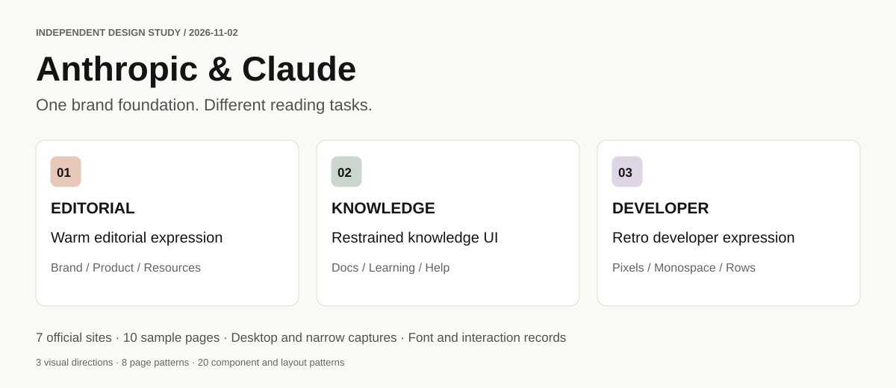
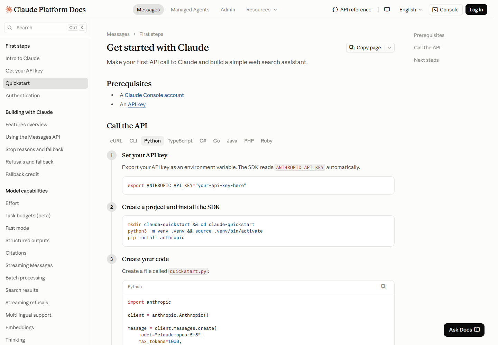
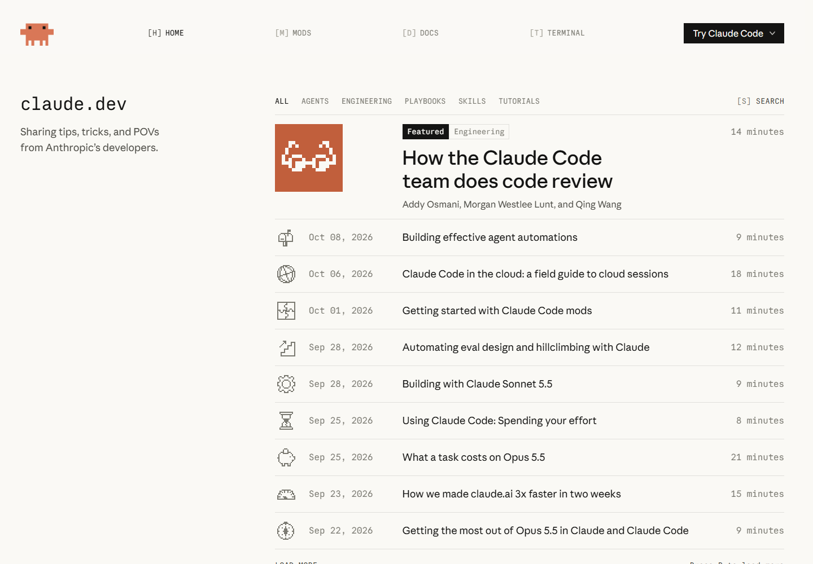

# Anthropic & Claude website design study

[中文](README.zh-CN.md) · **English** · [Read the HTML edition](https://aotushi.github.io/anthropic-design-study/html/en/index.html)

**An illustrated UI/UX handbook in Chinese and English, with a browser edition for reading and comparison.**

Explore how typography, color, space, imagery, and information structure connect Anthropic's company pages, Claude product pages, official courses, and developer documentation. Ten chapters combine screenshots, measured details, comparison tables, and practical design analysis.

> **Observed 2026-11-02 · Seven official sites · Ten representative pages.** Academy and Code Docs also have 390 × 844 narrow samples. See [methods and evidence](docs/en/07-methodology-and-sources.md) for scope and counting.

## Choose a reading format

| Format | Best for | Entry |
|---|---|---|
| HTML handbook | Chapter navigation, search, enlarged screenshots, print layouts | [English](https://aotushi.github.io/anthropic-design-study/html/en/index.html) · [中文](https://aotushi.github.io/anthropic-design-study/html/zh/index.html) |
| Interactive explorer | Side-by-side pages, measured heading sizes, filtered patterns | [Explore the evidence](https://aotushi.github.io/anthropic-design-study/html/en/explore.html) |
| GitHub documents | Reading source text, following records, reviewing changes | The chapter list below |
| Downloaded HTML | Reading and searching without a server | [Download repository ZIP](https://github.com/aotushi/anthropic-design-study/archive/refs/heads/main.zip), then open `html/en/index.html` |

## Chapters

| Question | Chapter |
|---|---|
| What creates a shared identity? | [01 Visual language](docs/en/01-visual-language.md) |
| Which fonts are used, and for what? | [02 Typography](docs/en/02-typography.md) |
| How do layouts change between tasks? | [03 Eight page patterns](docs/en/03-page-patterns.md) |
| Which component patterns are reusable? | [04 Twenty component and layout patterns](docs/en/04-components.md) |
| How do pages support reading and action? | [05 UX and responsive observations](docs/en/05-ux-and-responsive.md) |
| What do the original pages look like? | [06 Screenshot gallery](docs/en/06-gallery.md) |
| Where do the measurements come from? | [07 Methods and evidence](docs/en/07-methodology-and-sources.md) |
| How can the ideas inform another project? | [08 Application guide](docs/en/08-application-guide.md) |
| How do page regions work together? | [09 Page anatomy](docs/en/09-page-anatomy.md) |
| What stays consistent across sites? | [10 Cross-site design matrix](docs/en/10-cross-site-matrix.md) |

## Main findings

**The sites share a brand foundation while adapting their expression to the reader's task.** Company pages establish an impression through large statements and imagery; resource pages help people find material; documentation reserves space for articles and orientation; the developer blog uses pixel graphics and monospace details to signal its audience.

| Level | Sample classification | Meaning |
|---|---:|---|
| Visual directions | 3 | Warm editorial, restrained knowledge, retro developer |
| Page patterns | 8 | Company, product, pricing, resources, documentation, course, help, developer publication |
| Reusable patterns | 20 | Navigation, retrieval, presentation, comparison, and learning patterns |
| Principal font names | 5 | Anthropic Sans, Anthropic Serif, Anthropic Serif Display, Anthropic Mono, Paper Mono |
| Core font families | 4 | With Serif Display grouped into Serif |

These levels answer different questions about style, organization, reuse, and typography. Actual rendering and the support-center fallback are documented in [typography](docs/en/02-typography.md#declared-loaded-and-rendered-fonts).

## Three pages, three reading rhythms

| Brand and resources | Knowledge reading | Developer publication |
|---|---|---|
|  |  |  |
| [Source S04](https://claude.com/resources) | [Source S08](https://platform.claude.com/docs/en/get-started) | [Source S10](https://claude.dev/) |

## Shared foundations

- **Warm backgrounds with clear text.** Several samples combine paper-like light surfaces with near-black text.
- **Roles matter more than font count.** Serif often carries headings, sans serif carries reading and controls, and monospace carries code or technical identity.
- **Density follows the task.** Brand pages have more open compositions; documentation keeps orientation and text together; lessons foreground goals and continuation.
- **Decoration varies by site.** Resources uses line illustrations and floating cards; the developer blog pairs pixel graphics with monospace labels.

## Evidence and maintenance

The handbook connects **design analysis → original screenshots → browser measurements**. Every source page has a URL and a local record in the [source index](docs/en/07-methodology-and-sources.md#source-index).

Repository contents and maintenance

- `docs/` and `docs/en/`: the two language editions.
- `html/`: generated HTML, readable online or from a downloaded repository.
- `assets/screenshots/`: 15 original browser captures.
- `assets/diagrams/`: three explanatory diagrams in both languages.
- `data/`: samples, fonts, dimensions, colors, taxonomy, and interaction evidence.
- `web/`: shared styles, browser interactions, and the [build guide](web/README.md).
- `scripts/`: capture, build, and verification tools.

Run `python scripts/build_html.py`, `python scripts/validate.py`, and `python scripts/validate_html.py` after editing. See the [update guide](docs/en/07-methodology-and-sources.md#updating-the-study).

Original prose and diagrams use [CC BY 4.0](LICENSE). See the [materials notice](NOTICE.md) for screenshots, trademarks, and fonts.
