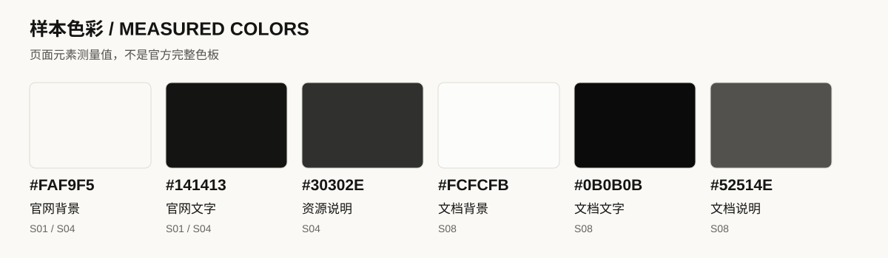
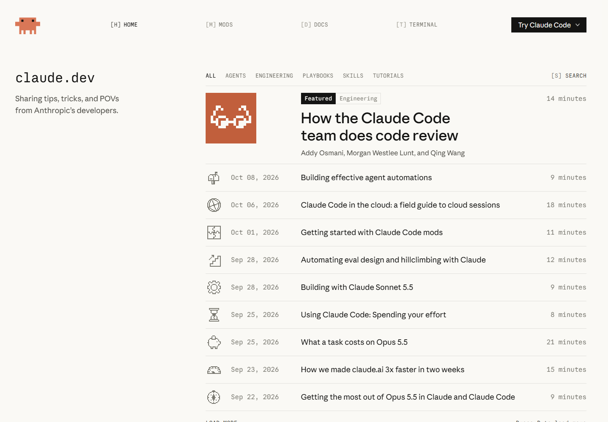

# 01 视觉语言

[返回总览](../README.md) · [下一章：字体与排版](02-typography.md)

## 统一感来自哪些地方

Anthropic 的公开网站反复出现浅色背景、深色文字、衬线标题和简洁控件。米白背景、衬线字形与充足留白，共同形成接近杂志与书籍的视觉气质。

这套基础进入不同页面后，会随内容任务改变密度与装饰程度：官网重视叙事与图像，文档突出正文与定位，开发者博客则通过等宽文字和像素图形形成自己的语气。

## 三种视觉方向

| 方向 | 可见特征 | 主要样本 | 设计解读 |
|---|---|---|---|
| 温暖的编辑式表达 | 米白背景、较大的衬线字、宽松段落、插画与图文编排 | 公司官网、产品、资源中心 | 把技术产品介绍组织得更接近出版物，适合建立第一印象和阅读叙事 |
| 克制的知识界面 | 中性色、细分隔线、稳定的导航区、较紧凑的控件 | Platform、Code Docs、Academy、帮助中心 | 让查找、阅读和执行下一步成为视觉中心 |
| 复古开发者表达 | 等宽标签、像素图形、方形或较直的边角、文章行列表 | claude.dev | 为开发者内容建立更鲜明的识别，与主品牌共享底色和部分字体 |

依据：[公司官网 S01](https://www.anthropic.com/)、[资源中心 S04](https://claude.com/resources)、[平台文档 S08](https://platform.claude.com/docs/en/get-started)、[开发者博客 S10](https://claude.dev/)。

## 色彩的职责

*图中整理了公司官网、资源中心与 Platform 文档的背景和文字色值，对应元素见下表。*

| 页面与元素 | 测量值 | 所承担的职责 |
|---|---|---|
| 公司官网与 Claude 资源中心的页面背景 | `#FAF9F5` | 让大面积空白带有轻微暖色 |
| 上述页面的基础文字 | `#141413` | 保持正文和主要信息的清晰度 |
| 资源中心首屏说明文字 | `#30302E` | 与标题形成轻微强弱差异 |
| Platform 文档页面背景 | `#FCFCFB` | 接近白色，支撑密集阅读 |
| Platform 文档基础文字 | `#0B0B0B` | 正文与控件的主要深色 |
| Platform 文档首屏说明文字 | `#52514E` | 将说明与标题层级分开 |

证据：[S01 测量](../data/pages/anthropic-home.json)、[S04 测量](../data/pages/claude-resources.json)、[S08 测量](../data/pages/platform-docs.json)。

色彩还承担不同层次的职责：橙褐色的品牌标志提供识别线索，插画中的浅粉与浅绿丰富内容，代码中的语法颜色帮助识别结构。

## 留白与视觉节奏

*图 1 · Claude Resources · 1440 × 1000 · [原站 S04](https://claude.com/resources)。*

这个首屏有三层节奏：外围文章卡片展示内容的丰富性，中间的标题与说明建立页面主题，搜索入口把视觉注意力转成一个可执行动作。浅网格提供位置感，但颜色较轻，避免抢过正文。

文档页把更多空间交给目录、文章和代码，形成更紧凑、连续的阅读节奏。**留白随页面任务分配**：资源首屏用空间突出主题，文档用空间区分导航、正文与辅助工具。

## 插画、图标与图像

| 形式 | 样本中可见的处理 | 在阅读中的作用 |
|---|---|---|
| 线描插画 | 资源卡片上的书、人物或对象轮廓，局部填充柔和颜色 | 区分内容并降低大面积文字的单调感 |
| 像素图形 | 开发者博客的角色与文章图形 | 形成该站点的技术与游戏化视觉语气 |
| 产品演示 | 产品页展示任务与成果场景 | 将抽象的能力说明转化为具体使用情境 |
| 小尺寸界面图标 | 搜索、复制、目录和箭头 | 支持操作识别；部分站点由 Anthropicons 字库绘制 |

*图 2 · claude.dev · [原站 S10](https://claude.dev/)。像素图形与等宽标签共同构成开发者博客的视觉识别。*

## 边界、圆角与阴影

卡片常以浅边框和轻微背景差分区，主要按钮使用深色实心填充。资源卡片、定价卡片、文档代码框与博客控件采用不同的圆角和尺寸，分别适应内容展示、方案比较、代码阅读与列表操作。

这些细节形成了清晰的分工：**用边框表达分组，用填充表达操作优先级，用空间表达段落关系。**

[下一章：字体与排版](02-typography.md)
