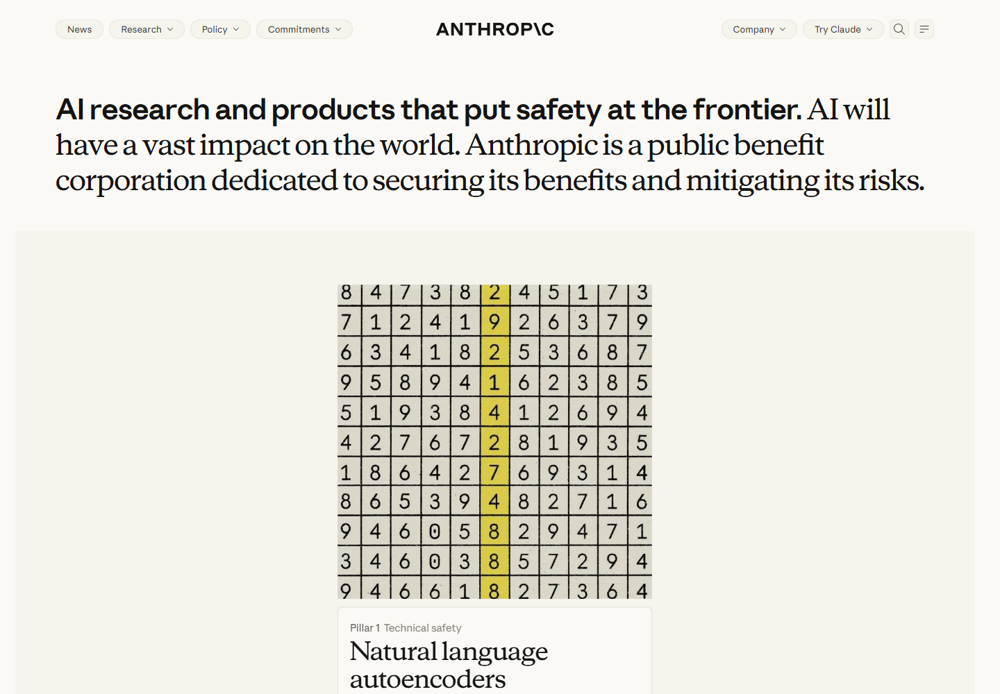
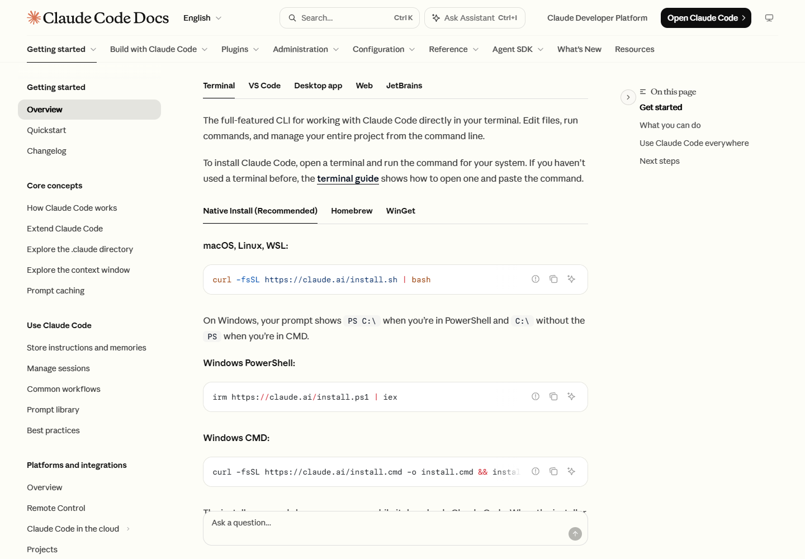

# 02 字体与排版

[返回总览](../README.md) · [上一章：视觉语言](01-visual-language.md) · [下一章：页面模式](03-page-patterns.md)

## 五个主要名称与四个核心家族

在这次官方公开页面样本中，主要文字字体可归纳为下表。这里同时核对页面的字体设置、已加载字体，以及选定文字元素实际使用的字体；不是凭截图猜测字体名称。

| 名称 | 字体类别 | 主要角色 | 证据 |
|---|---|---|---|
| **Anthropic Sans** | 无衬线 | 正文、导航、按钮、卡片说明 | [S04](../data/pages/claude-resources.json)、[S05](../data/pages/academy-home.json)、[S08](../data/pages/platform-docs.json) |
| **Anthropic Serif** | 衬线 | 品牌标题、页面标题、部分卡片标题 | [S01](../data/pages/anthropic-home.json)、[S04](../data/pages/claude-resources.json)、[S05](../data/pages/academy-home.json) |
| **Anthropic Serif Display** | 衬线展示变体 | Claude Code 文档标题 | [S07](../data/pages/code-docs.json) |
| **Anthropic Mono** | 等宽 | Platform 代码、开发者博客标题及标签 | [S08](../data/pages/platform-docs.json)、[S10](../data/pages/developer-blog.json) |
| **Paper Mono** | 等宽 | Claude Code 文档代码块 | [S07](../data/pages/code-docs.json)、[代码区进一步核验](../data/interaction-checks.json) |

按页面中的主要字体名称计为 **5 个**；将 Serif Display 作为 Serif 的展示变体归并，则为 **4 个核心家族**。这个口径不把同一字体的粗体、斜体、变量版本或备用名称重复计算。

## 三种职责，而不是三条绝对规则

**标题营造语气，正文保持易读，等宽文字表达技术结构。** 这是一种反复出现的分工，但不是“所有标题都是衬线字体”的规则。

*图 3 · [Anthropic 公司首页 S01](https://www.anthropic.com/) · 同一段主标题的开头使用无衬线字体，后续说明使用衬线字体。下方内容为该时刻的动态展示帧。*

公司首页的这个混排尤其值得注意。它通过字形与字重的变化，把简短的主张与较长的说明放在同一段视觉结构中。如果只检查标题容器的字体名称，就会漏掉内部文字的变化；本次浏览器的渲染记录同时识别到 Sans 和 Serif。

开发者博客是另一个例外：它的站名标题使用 Anthropic Mono。字体选择在这里承担站点识别作用，而不仅是展示代码。

## 真实页面中的字号层级

以下数值均为本次 **1440 × 1000** 桌面视口下的抽样结果；行高以像素表示。它们不是一套可直接照搬的官方排版规范。

| 页面与文字角色 | 字号 | 行高 | 字重 | 来源 |
|---|---:|---:|---:|---|
| Claude Resources 主标题 | 72 | 79.2 | 500 | [S04](../data/pages/claude-resources.json) |
| Resources 首屏说明 | 23 | 34.5 | 400 | [S04](../data/pages/claude-resources.json) |
| Pricing 主标题 | 64 | 70.4 | 500 | [S03](../data/pages/claude-pricing.json) |
| Academy 首页主标题 | 48 | 52.8 | 400 | [S05](../data/pages/academy-home.json) |
| Academy 首页说明 | 18 | 28 | 400 | [S05](../data/pages/academy-home.json) |
| Academy 课程内页主标题 | 36 | 54 | 400 | [S06](../data/pages/academy-lesson.json) |
| Code Docs 主标题 | 36 | 40 | 400 | [S07](../data/pages/code-docs.json) |
| Code Docs 介绍段落 | 16 | 26.4 | 400 | [S07](../data/pages/code-docs.json) |
| Code Docs 代码 | 14 | 24 | 400 | [S07](../data/pages/code-docs.json) |
| Platform 文档主标题 | 26.25 | 32.8125 | 520 | [S08](../data/pages/platform-docs.json) |
| 开发者博客站名 | 31.5 | 34.65 | 400 | [S10](../data/pages/developer-blog.json) |

可以看到，营销和资源入口使用较大的标题，而文档用更紧凑的标题为正文留出空间。不能用“Anthropic 标题统一是 72px”概括这些页面；同样，变量字体中出现的 520 字重也不应被强行写成 500 或 600。

## 两个文档站的等宽字体并不相同

*图 4 · [Claude Code 文档 S07](https://code.claude.com/docs/en/overview) · 代码区的 Paper Mono 与 Platform 文档的 Anthropic Mono 是不同的字体选择。*

两站共享“正文与代码区分开”的阅读逻辑，但使用不同的等宽字体。对设计复用而言，更值得保留的是代码和自然语言之间的清晰边界，以及复制、平台切换等操作与内容的接近程度。

## 声明加载与实际渲染

| 层次 | 能回答的问题 | 容易发生的误判 |
|---|---|---|
| 页面声明 | 设计设置希望优先使用什么字体 | 名称出现不等于文件已经加载 |
| 字体加载 | 浏览器是否加载了某个字体资源 | 资源已加载不等于所有文字都用了它 |
| 实际渲染 | 抽样文字的字形来自什么字体 | 单个元素不能代表全页、所有语言和所有状态 |

**帮助中心是本次的重要例外。** 它声明了 Anthropic Sans、Anthropic Serif 的站点别名，并为快捷键提示指定 JetBrains Mono。但在本次浏览器抽样中，正文和标题回退到 Times New Roman，快捷键回退到 Consolas。因此：

- JetBrains Mono 记录为“局部声明”，不纳入已确认使用的核心字体数量。
- Times New Roman 和 Consolas 是本次环境的回退结果，不被描述为 Anthropic 的主品牌选择。
- 帮助中心截图主要支持布局研究，不能据此判断其字体成功加载后的外观。

具体字段见 [S09 的 renderedFonts 与 fontRuleSources](../data/pages/support-home.json)。本报告不将本次回退外推为所有用户都会遇到的问题。

## 字体别名与非文字字库

| 样本中出现的名称 | 研究中的归并 |
|---|---|
| `anthropicSans`、`anthropic-sans`、`Anthropic Sans` | Anthropic Sans |
| `anthropicSerif`、`anthropic-serif` | Anthropic Serif |
| `anthropicMono`、`Anthropic Mono` | Anthropic Mono |
| 含 Fallback 的名称，以及 Arial、Georgia 等后备项 | 不独立计为核心品牌字体 |
| `Anthropicons-Variable` | 图标字库，不计入文字字体 |
| 字体文件中的 Text、Web、Variable、Light 等描述 | 保留在原始证据中，不自动视为新的设计家族 |

这些归并用于本次研究，并不替代字体厂商的完整命名目录。没有逐一核对字体许可或分发字体文件。

## 中文使用的边界

原站样本主要是英文。字体栈中出现中文或其他语言的备用字体，不能证明 Anthropic Sans 或 Serif 本身覆盖了这些文字。若将类似排版用于中文，需要单独测试中文字体、标点、字重、混排和换行；不能仅凭英文截图确认效果。

[下一章：八类页面模式](03-page-patterns.md)
