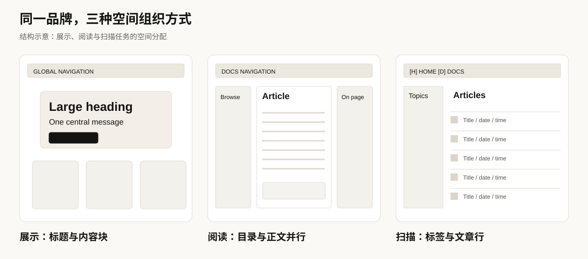
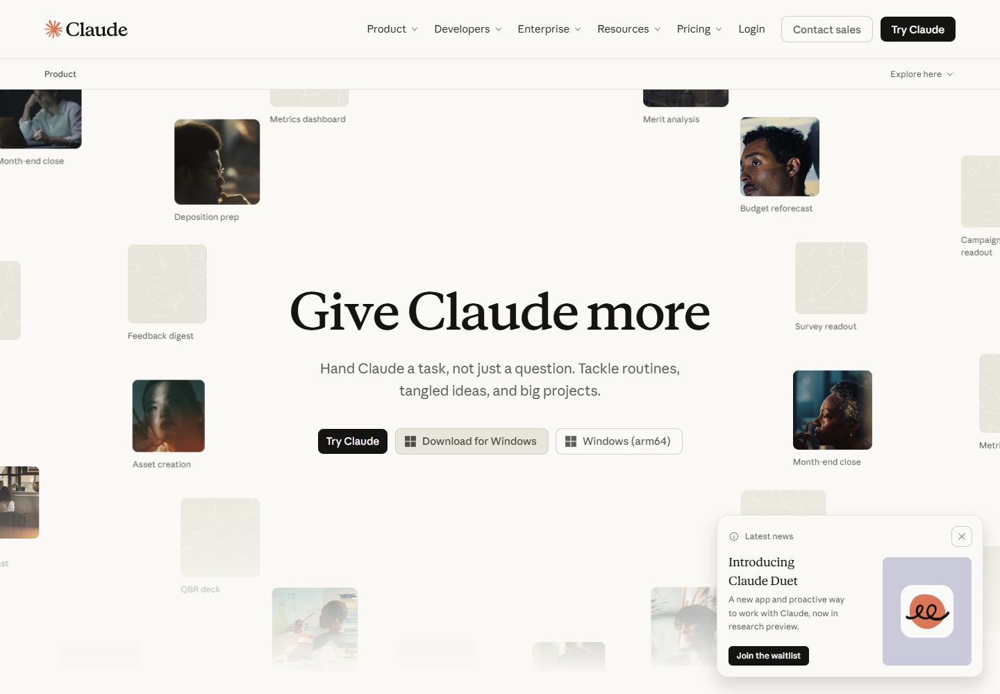
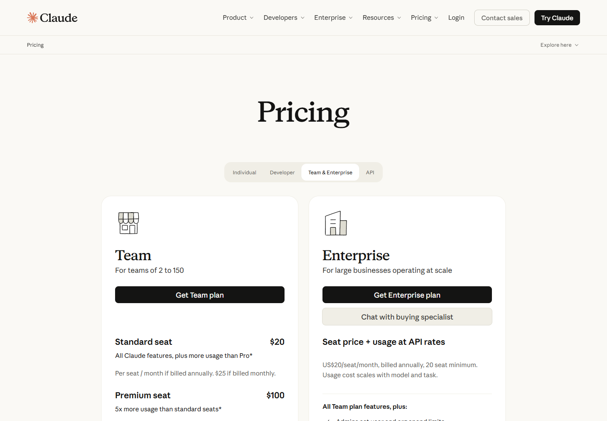
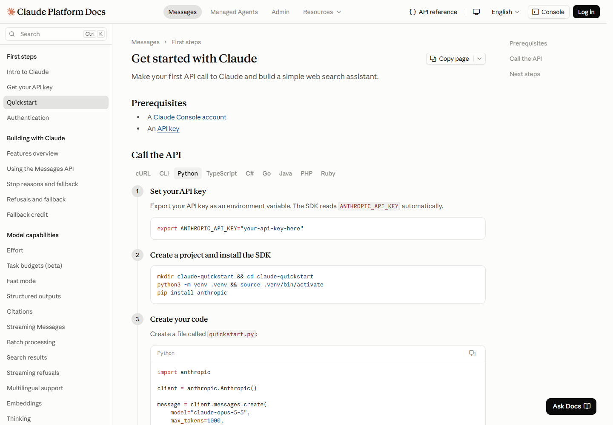

# 03 八类页面模式

[返回总览](../README.md) · [上一章：字体与排版](02-typography.md) · [下一章：组件](04-components.md)

## 为什么按任务归类

域名数量并不等于设计模式数量。两个不同域名的文档可能采用相近的结构；同一个 Claude 官网又同时包含产品、定价和资源页面。因此，本章按读者在页面上要完成的主要任务，归纳为八类。

*图为研究者绘制的结构示意，不是官网像素级还原。实际尺寸与外观以截图为准。*

## 总体对照

| 类型 | 用户的主要问题 | 页面结构 | 代表样本 |
|---|---|---|---|
| 1 公司与品牌官网 | 这家公司关注什么 | 主张、重点内容、文章入口、公司导航 | [S01](https://www.anthropic.com/) |
| 2 产品介绍 | 产品能帮我做什么 | 标题与动作、使用场景、能力说明、常见问题 | [S02](https://claude.com/product/overview) |
| 3 定价比较 | 哪种方案适合我 | 人群切换、套餐卡片、功能比较、说明 | [S03](https://claude.com/pricing) |
| 4 内容资源库 | 我需要的内容在哪里 | 内容分类、搜索、筛选、卡片与专题分组 | [S04](https://claude.com/resources) |
| 5 技术文档 | 怎样完成具体技术任务 | 导航树、正文、页内目录、步骤和代码 | [S07](https://code.claude.com/docs/en/overview)、[S08](https://platform.claude.com/docs/en/get-started) |
| 6 课程学习 | 学什么，如何继续 | 学习入口、目标、课时、章节、视频和文字 | [S05](https://academy.claude.com/)、[S06](https://academy.claude.com/courses/ai-fluency-framework-foundations/introduction-to-ai-fluency) |
| 7 帮助知识库 | 如何解决当前问题 | 搜索、问题分类、热门文章、文章集合 | [S09](https://support.claude.com/en/) |
| 8 开发者出版物 | 有什么新经验值得阅读 | 类别、日期、作者、阅读时间、文章行列表 | [S10](https://claude.dev/) |

这八类是本次样本的用途分类。长文章、搜索结果和某些产品专题还可以继续细分，本文没有把未逐页检查的变体另计为确定数量。

## 1 公司与品牌官网

Anthropic 首页的主张区采用混合字形的大段文字，随后展示重点内容与文章入口。与产品页面相比，它首先解释公司的关注点，而非立即组织一组套餐或操作步骤。

**设计解读：** 在读者尚未确定具体任务时，编辑式编排提供一个理解公司的入口。主张文字的长度也意味着窄屏换行与阅读负担需要单独考虑；桌面截图不能替代移动端验证。

## 2 产品介绍

产品页将主题、主要动作和场景演示放在显著位置，再逐步展开能力与使用方式。页面中的任务示例承担解释产品的职责；这些嵌入展示不是本研究对真实对话界面的访问。

*图 5 · [S02](https://claude.com/product/overview) · 首屏包含动态内容，截图保留采集时刻的状态。*

**设计解读：** 场景比孤立的功能名更容易传达用途，但需要用清楚的说明避免读者把演示当作适用于所有任务的保证。截图仅用于研究页面表达，不验证示例输出质量。

## 3 定价比较

*图 6 · [S03](https://claude.com/pricing) · 实际切换到 Team & Enterprise 后的页面。截图中的价格不作为持续有效的购买信息。*

定价页先让读者选择 Individual、Team & Enterprise 或 API，再展示对应内容。套餐卡片支持快速判断，功能表支持逐项比较。这两个层次回答的是不同问题，因此同时存在。

本次操作确认切换会改变选中状态并显示对应套餐。测试没有进入购买、登录或联系销售流程。[交互记录](../data/interaction-checks.json)

## 4 内容资源库

资源中心包含首页、文章、指南、网络研讨会和视频等分类入口，使用搜索和筛选缩小范围。卡片上的类型、日期或阅读信息帮助用户在进入全文前判断是否相关。

**设计解读：** 资源库同时面向“随便看看”和“带问题来找内容”的读者。较丰富的首屏承担探索入口的职责，而分类、搜索与列表承担定向检索；不能只评价首屏是否漂亮。

## 5 技术文档

*图 7 · [S08](https://platform.claude.com/docs/en/get-started)。*

桌面布局将三个问题同时呈现：

- 左侧导航回答“我在整个文档体系的哪里”。
- 中央正文回答“这个任务如何完成”。
- 右侧目录回答“当前文章有哪些部分”。

Code Docs 与 Platform Docs 共享这类结构，但字体细节、代码区和控件存在差异。因此本研究将其归为一种页面模式，而不是宣称两站由同一套实现或同一份组件库生成。

## 6 课程学习

Academy 首页帮助选择学习方向，课程内页提供目标、课时、视频、总结或文字稿、练习和后续内容。与技术文档相比，它更强调学习顺序和阶段目标。

*图 8 · [S06](https://academy.claude.com/courses/ai-fluency-framework-foundations/introduction-to-ai-fluency) · 播放器可能处于资源加载状态；文字结构仍可观察。*

本研究验证公开页面的内容结构与文字稿切换。登录后保存进度、测验评分和完成徽章的行为没有测试，不能据此评价完整学习流程。

## 7 帮助知识库

帮助中心把搜索与主题集合放在显著位置，同时列出常见问题。与课程的顺序学习相比，它支持直接进入一个待解决的问题。

**设计解读：** 用户可能只需要完成一项短任务，因此分类名称、搜索结果和文章之间的返回关系，比装饰丰富度更关键。本次没有测量搜索命中率或问题解决率。

该站点的截图出现字体回退，分析时仅据此判断布局，字体意图另看声明证据。

## 8 开发者出版物

开发者博客用文章行呈现标题、日期和阅读时间，配合类别筛选与像素图形。与资源中心的大量卡片相比，列表更突出连续扫描和快速比较。

本次选择 TUTORIALS 后，匹配的文章数量变化，再切回 ALL 恢复。具体数量属于采集时刻的结果，不作为固定产品规则。[交互记录](../data/interaction-checks.json)

[下一章：二十类组件与布局模式](04-components.md)
