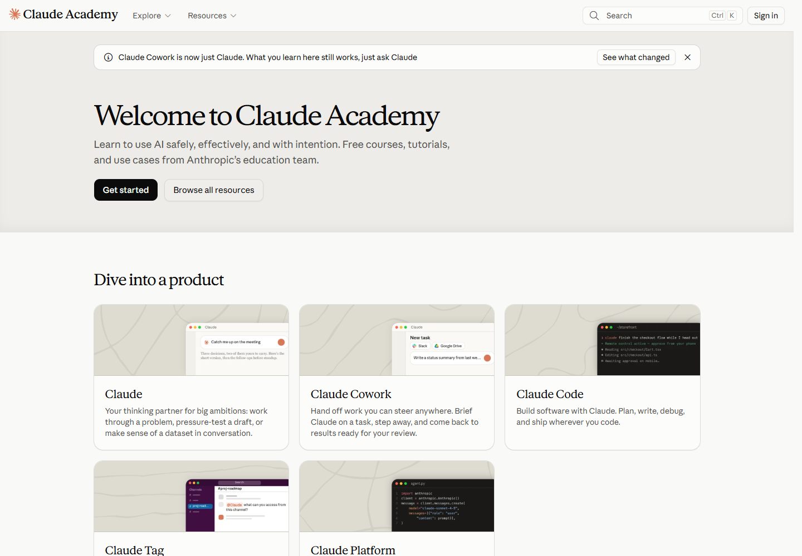

# 04 二十类组件与布局模式

[返回总览](../README.md) · [上一章：页面模式](03-page-patterns.md) · [下一章：UX 与响应式](05-ux-and-responsive.md)

## 按任务组织组件

本章将可复用的组件与局部布局归为五组，每组四类：导航、检索与切换、内容展示、比较与步骤、学习与阅读辅助。每种模式都对应一个具体任务，例如卡片网格组织内容浏览，套餐卡片组织方案比较。

## 导航模式

| 编号 | 模式 | 样本中的表现 | 解决的问题 |
|---|---|---|---|
| P01 | 顶部下拉导航 | 主导航按产品、开发者、资源等组织入口 | 从全站范围选择方向 |
| P02 | 二级分类栏 | Resources 中的文章、指南、视频等入口 | 在当前内容区切换类别 |
| P03 | 面包屑 | 课程与文档显示上层位置 | 理解所在层级并返回 |
| P04 | 侧边导航与目录 | 文档导航树、页内目录、课程章节 | 在长内容中定位并跳转 |

证据：[资源中心 S04](https://claude.com/resources)、[课程 S06](https://academy.claude.com/courses/ai-fluency-framework-foundations/introduction-to-ai-fluency)、[文档 S07](https://code.claude.com/docs/en/overview)。

P01、P02 和 P04 分别处理全站方向、当前分类和文章内部的位置。顶部、分类栏与侧边区域将这些导航分开，让不同范围的定位任务各有入口。

## 检索与内容切换

| 编号 | 模式 | 样本中的表现 | 解决的问题 |
|---|---|---|---|
| P05 | 站内搜索 | 资源、帮助中心与文档的搜索入口 | 直接寻找目标内容 |
| P06 | 分类筛选 | 开发者博客按主题筛选文章 | 缩小候选范围 |
| P07 | 标签页与分段选择 | 定价人群、代码平台或语言切换 | 在同一上下文切换相关内容 |
| P08 | 展开与收起 | 常见问题、分组导航等按需展开 | 控制信息密度 |

证据：[定价 S03](https://claude.com/pricing)、[Code Docs S07](https://code.claude.com/docs/en/overview)、[博客 S10](https://claude.dev/)。P06 与 P07 的实际状态变化见[交互记录](../data/interaction-checks.json)。

搜索、筛选和标签页的外观可能都很紧凑，但行为不同：搜索接受开放式问题，筛选约束内容集合，标签页切换预先组织的内容。复用样式时应保留这些行为差异。

## 内容展示

| 编号 | 模式 | 样本中的表现 | 解决的问题 |
|---|---|---|---|
| P09 | 大标题首屏 | 标题、简短说明和主要动作集中 | 建立页面主题 |
| P10 | 卡片网格 | 课程、产品入口和资源卡片 | 浏览一组并列选择 |
| P11 | 文章行列表 | 博客的日期、标题与阅读时间按行排列 | 快速扫描与比较 |
| P12 | 产品演示区 | 场景、任务或成果的视觉展示 | 解释抽象能力如何使用 |

证据：[产品 S02](https://claude.com/product/overview)、[资源 S04](https://claude.com/resources)、[Academy S05](https://academy.claude.com/)、[博客 S10](https://claude.dev/)。

*图 9 · [S05](https://academy.claude.com/) · 卡片同时包含主题名称、说明与配图，辅助选择学习方向。*

卡片适合每项都有独立说明或图像的集合；行列表适合字段相似、需要连续扫描的内容。选择方式取决于内容结构和读者的比较任务。

## 比较与步骤引导

| 编号 | 模式 | 样本中的表现 | 解决的问题 |
|---|---|---|---|
| P13 | 套餐卡片 | 方案名称、价格、动作与特性组成一个单元 | 建立方案的整体印象 |
| P14 | 功能比较表 | 同一功能横向比较多个方案 | 支持细节判断 |
| P15 | 编号步骤 | 文档用步骤序号连接配置和操作 | 显示执行顺序 |
| P16 | 下一课或下一步链接 | 课程结尾指向后续内容 | 减少完成当前内容后的停顿 |

证据：[定价 S03](https://claude.com/pricing)、[课程 S06](https://academy.claude.com/courses/ai-fluency-framework-foundations/introduction-to-ai-fluency)、[Platform S08](https://platform.claude.com/docs/en/get-started)。

完整的步骤需要连接前提、操作与结果；有效的比较表需要突出与选择有关的差异。序号和表格分别为这两种信息关系提供了稳定结构。

## 学习与阅读辅助

| 编号 | 模式 | 样本中的表现 | 解决的问题 |
|---|---|---|---|
| P17 | 视频与文字内容切换 | 课程提供总结或文字稿入口 | 支持不同阅读方式 |
| P18 | 重点提示框 | 学习目标或必要说明单独成组 | 提前建立阅读预期 |
| P19 | 代码块与复制 | 命令或代码与复制入口相邻 | 减少执行时的转录工作 |
| P20 | 课时与位置提示 | 课程序号、时长或章节位置标签 | 帮助判断投入与当前位置 |

证据：[课程 S06](https://academy.claude.com/courses/ai-fluency-framework-foundations/introduction-to-ai-fluency)、[Code Docs S07](https://code.claude.com/docs/en/overview)、[Platform S08](https://platform.claude.com/docs/en/get-started)。

课时说明学习投入，章节提示当前阅读位置；代码与复制入口相邻，将阅读内容与执行准备连接起来。这些辅助信息贴近正文，方便在需要时取用。

## 跨站一致与局部差异

| 较一致的表达 | 会随任务变化的表达 |
|---|---|
| 深色主要动作、浅色次级背景 | 按钮和卡片的圆角、尺寸、排列 |
| 标题与正文具有不同视觉层级 | 标题是否采用衬线或等宽字体 |
| 导航与正文通过空间或分隔线区分 | 导航在顶部、侧边还是折叠菜单中 |
| 代码与自然语言有明显区别 | 代码字体、语言切换方式与代码框细节 |

共同的文字层级、明暗关系和空间分区建立品牌一致性，圆角、尺寸、字体与导航位置则随页面任务变化。

[下一章：UX 与响应式观察](05-ux-and-responsive.md)
