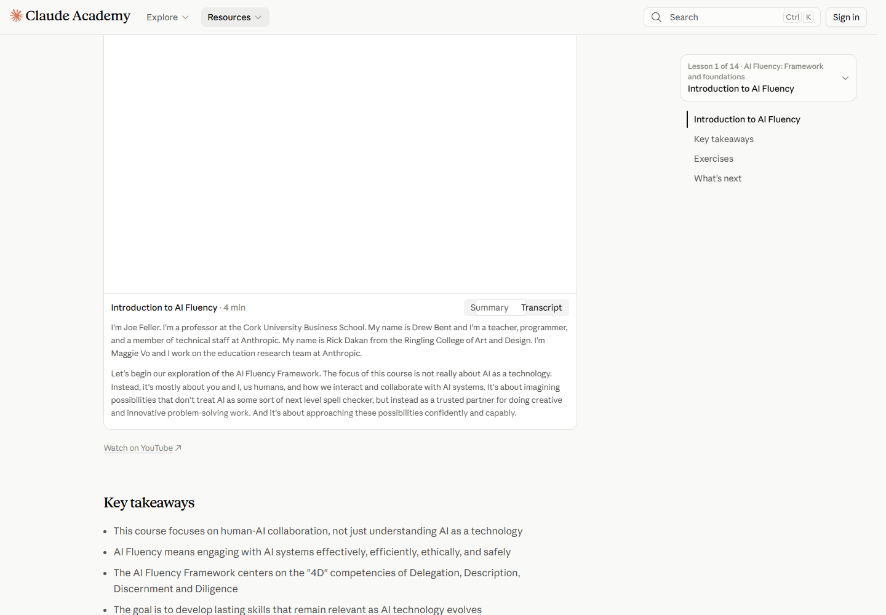
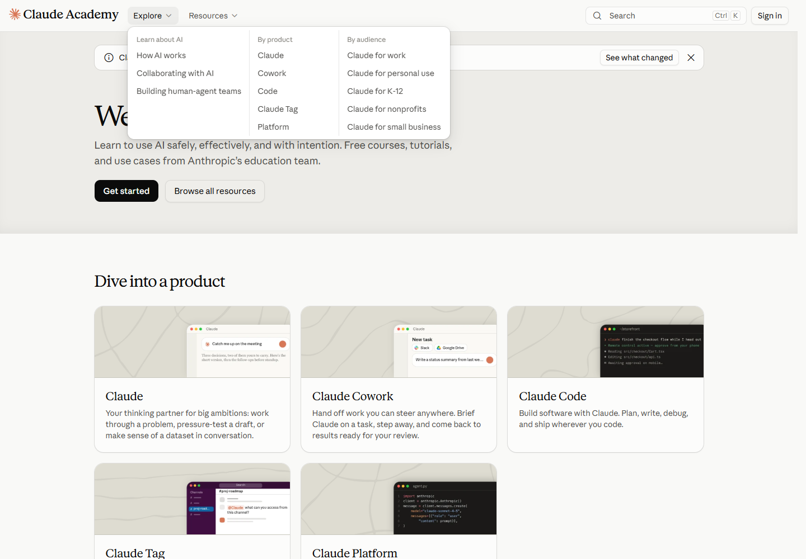
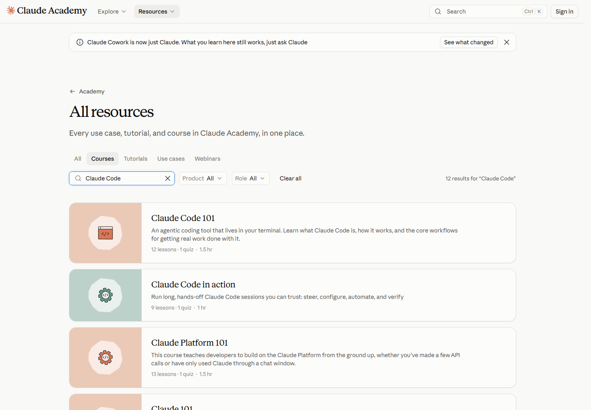
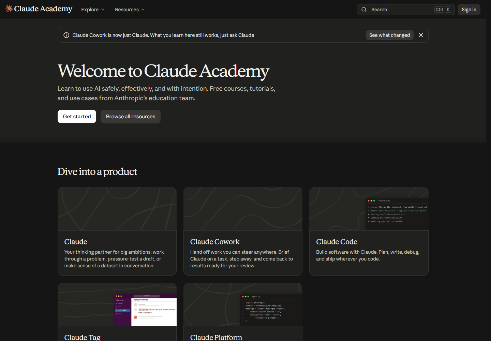
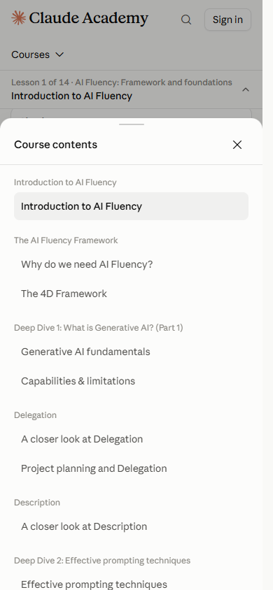
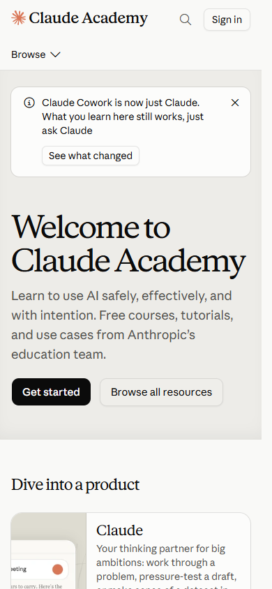
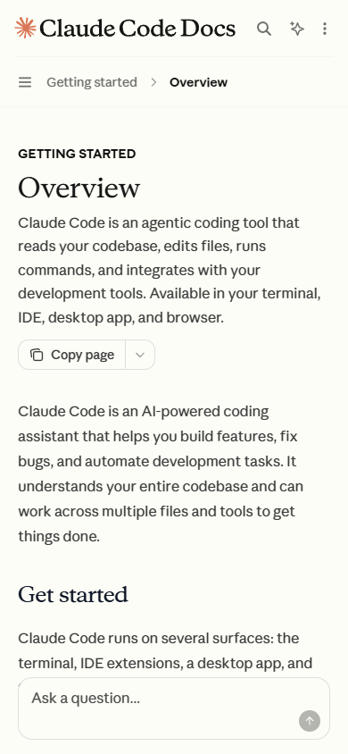

# 05 UX 与响应式观察

**中文** · [English](en/05-ux-and-responsive.md)

[返回总览](../README.zh-CN.md) · [上一章：组件](04-components.md) · [下一章：截图图库](06-gallery.md)

## 页面如何帮助用户继续行动

视觉层级和信息结构需要一起看。一个大标题能够吸引注意，但用户还需要知道下一步；一份长文内容充分，也需要有定位和返回路径。

| 使用情境 | 样本中的辅助方式 | 设计解读 |
|---|---|---|
| 初次了解产品 | 简短说明、场景、突出主要动作 | 先建立用途，再引导行动 |
| 比较方案 | 人群切换、套餐卡片、详细比较表 | 把快速判断与细节核对分层 |
| 查找技术内容 | 导航树、搜索、页内目录 | 同时支持浏览与定向定位 |
| 逐步执行 | 编号步骤、代码区、相邻复制入口 | 将说明与执行对象放在一起 |
| 顺序学习 | 学习目标、课时信息、下一课 | 为阅读提供起点与后续方向 |

## 已操作核验的交互

以下结果来自公开页面的实际操作，原始记录见 [interaction-checks.json](../data/interaction-checks.json)。

| 检查 | 本次观察结果 | 观察对象 |
|---|---|---|
| 定价的人群切换 | Individual 切换为 Team & Enterprise，显示对应套餐 | 标签选中状态与套餐标题 |
| 博客的主题筛选 | 列表由 10 项变成 1 项，恢复 ALL 后回到 10 项 | 分类选择与可见文章数量 |
| 课程的文字稿切换 | Transcript 被选中，选中状态正确更新 | 内容切换控件的选中状态 |
| 文档代码字体 | 代码文字实际由 Paper Mono 渲染 | 代码区抽样文字 |
| 资源页首次键盘焦点 | 首次 Tab 到达 Skip to main content 链接 | 跳过导航的键盘入口 |

*图 10 · [课程 S06](https://academy.claude.com/courses/ai-fluency-framework-foundations/introduction-to-ai-fluency) · 顶部视频区域在采集时为空白加载状态，文字稿切换与下方文字可用。*

在这节课程中，视频与文字提供了两种学习方式。视频资源尚未就绪时，文字内容与章节目录仍然可用。

## Academy 交互研究

**2026-11-03 追加检查了 9 类交互，其中 8 类用于本手册。** [Claude Academy](https://academy.claude.com/) 是这次调整的主要参照：读者能直观看出卡片可以点击，缩小资源范围，选择学习路线，并在课程中保持位置感。追加检查使用独立的公开页面浏览会话，视口为 1440 × 1000 与 390 × 844。[操作与测量记录](../data/academy-interactions.json)

| 交互类型 | Academy 上的实际表现 | 本手册的采用判断 |
|---|---|---|
| **1. 卡片悬停** | 抽样产品与课程卡片的内部插画在 **300ms** 内放大至 **1.04 倍**，采用 ease-out 曲线，并出现轻微覆盖色；文字和外框保持位置。 | **采用。** 主题卡和章节卡在悬停及键盘聚焦时响应，标题保持稳定，便于持续阅读。 |
| **2. 分组菜单** | 悬停 Explore 展开三列导航，Escape 可关闭；Resources 使用较小的下拉菜单。 | **采用。** Explore 按主题组织章节，Resources 集中总览、交互对照与证据入口，同时支持点击和键盘操作。 |
| **3. 全局搜索** | 顶栏搜索打开浮层；在检查状态下，输入“Claude Code”显示六个结果选项。 | **保留并完善。** 搜索本手册各章节的小节，支持方向键选择，Escape 关闭后返回搜索按钮。 |
| **4. 资源筛选** | 在[全部资源](https://academy.claude.com/all)中选择 Courses 并搜索“Claude Code”，卡片、计数及地址同步变化为 `?kind=course&q=Claude+Code`；当次检查由 28 门课程变为 12 条结果。 | **转化采用。** 四个主题标签与章节搜索同步更新卡片、结果数和可分享地址，提供清除操作与无结果提示。 |
| **5. 引导式入口** | [Get started](https://academy.claude.com/start) 中选择 Claude Code 后，继续选择个人使用学习或团队部署路线。 | **简化采用。** 三张插画主题卡直接筛选相关章节；十章内容只需一次选择即可进入。 |
| **6. 主题切换** | 顶栏主题按钮将浅色页面切换为深色页面。 | **采用。** 提供浅色与深色阅读模式，在浏览器中记住选择；研究截图保留原始颜色。 |
| **7. 内容形式切换** | [AI Fluency 课程](https://academy.claude.com/courses/ai-fluency-framework-foundations/introduction-to-ai-fluency)的 Summary 与 Transcript 为单选控件组；选择文字稿后，选中状态与文本一起改变。 | **转化采用。** 交互对照页的每个样本都可以切换“截图 / 分析”，从两种方式阅读同一页面。 |
| **8. 课程位置与导航** | 课程显示当前进度位置、章节选择器、页内链接与下一课入口；390px 宽度下，章节按钮展开包含课程列表的浮层。 | **转化采用。** 桌面正文旁显示当前章节、章节选择器及小节导航；窄屏使用章节抽屉，并保留上一章与下一章入口。 |
| **9. 加载更多** | 资源目录中点击 Load more，已渲染卡片从 **24 张增加至 48 张**。 | **不采用。** 十章内容适合一次完整展示；筛选有价值，额外的加载步骤没有必要。 |

### 菜单与可感知的反馈

*Academy 交互截图 A1 · [首页](https://academy.claude.com/) · 1440 × 1000 · 2026-11-03。展开面板将入口分成不同列，背景页面仍然可见。*

卡片的动态幅度很小，但反馈明确。插画放大让可点击区域产生响应，标题和卡片占位保持稳定。本手册把相同反馈用于键盘聚焦；读者选择减少动态效果时，插画保持静止。菜单使用短暂的入场过渡，主题标签用下划线标明选中状态，筛选后的卡片以轻微过渡出现。

### 能说明当前状态的资源列表

*Academy 交互截图 A2 · [筛选后的目录](https://academy.claude.com/all?kind=course&q=Claude+Code) · 1440 × 1000 · 2026-11-03。*

选中分类、输入内容、结果数量和卡片列表共同描述同一个状态，这比单独让标签产生动画更有用。本手册将这一关系用于章节库：筛选地址可以复制分享，刷新后可恢复，浏览器后退可回到上一个主题，中英文切换也保留筛选。清除条件后重新展示全部十章。

### 阅读界面的另一种主题

*Academy 交互截图 A3 · [首页](https://academy.claude.com/) · 1440 × 1000 · 2026-11-03。*

主题切换改变阅读背景、控件与文字层级。研究截图仍然是原始材料：本手册在两种主题下均保留截图的采集颜色，便于继续比较各站点的色彩选择。

### 窄屏中的课程导航

*Academy 交互截图 A4 · [AI Fluency 课程](https://academy.claude.com/courses/ai-fluency-framework-foundations/introduction-to-ai-fluency) · 390 × 844 · 2026-11-03。*

课程列表通过明确的浮层呈现，阅读栏保留空间。本手册以章节抽屉承担同样的任务。宽屏时，紧凑的章节选择器位于正文右侧，下方小节链接跟随阅读位置更新；文末的下一章入口支持按顺序继续阅读。

## 桌面与窄屏对照

<table>
<tr><th>Academy：390 × 844</th><th>Code Docs：390 × 844</th></tr>
<tr>
<td></td>
<td></td>
</tr>
</table>

*图 11–12 · 两页均在桌面浏览器中以 390 × 844 视口采集。*

| 观察点 | 桌面 1440px 宽 | 窄屏 390px 宽 |
|---|---|---|
| Academy 主标题 | 48px，行高 52.8px | 44px，行高 48.4px；标题分行 |
| Academy 首页说明 | 18px，行高 28px | 保持 18px、28px |
| Academy 内容入口 | 多列卡片 | 纵向单列，局部图文关系调整 |
| Code Docs 主标题 | 36px，行高 40px | 30px，行高 36px |
| Code Docs 介绍段落 | 16px，行高 26.4px | 保持 16px、26.4px |
| Code Docs 导航 | 左侧导航、中央正文、右侧目录 | 主阅读区单列，导航以紧凑入口呈现 |
| 整个文档的横向溢出 | 两个样本均未检测到 | 两个样本均未检测到 |

来源：[Academy 桌面](../data/pages/academy-home.json)、[Academy 窄屏](../data/pages/academy-home-mobile.json)、[Code Docs 桌面](../data/pages/code-docs.json)、[Code Docs 窄屏](../data/pages/code-docs-mobile.json)。

窄屏布局通过**重新分配空间**适应阅读：部分标题缩小，正文保持字号，导航收进紧凑入口，卡片转为单列。内容的优先顺序因此比桌面布局的原始比例更重要。

## 四组文字对比度检查

以选定文字颜色和最近的不透明祖先背景进行计算，结果如下。资源中心首屏文字位于 `#F5F4ED` 面板上，外层页面背景则为 `#FAF9F5`；对比度使用文字所在面板的颜色。

| 抽样位置 | 文字 | 背景 | 对比度，约 |
|---|---|---|---:|
| Resources 标题 | #141413 | #F5F4ED | 16.72 : 1 |
| Resources 首屏说明 | #30302E | #F5F4ED | 11.99 : 1 |
| Platform 标题 | #0B0B0B | #FCFCFB | 19.17 : 1 |
| Platform 首屏说明 | #52514E | #FCFCFB | 7.73 : 1 |

W3C 对普通文字的最低对比度要求为 4.5 : 1，符合条件的大字为 3 : 1；存在规范规定的例外。[W3C 对比度说明](https://www.w3.org/WAI/WCAG22/Understanding/contrast-minimum.html)

上述四组均高于普通文字阈值。两页通过深色标题与稍浅的说明文字建立层级，同时让说明文字保持较高对比度。[计算数据](../data/derived-checks.json) · [计算脚本](../scripts/analyze.py)

## 将观察转化为设计判断

| 设计要点 | 页面中的具体做法 | 应用时关注什么 |
|---|---|---|
| 状态与内容对应 | 定价标签切换时更新对应套餐 | 选中样式和当前内容保持一致 |
| 学习方式可选择 | 课程提供文字稿入口 | 让替代内容与主内容一样容易找到 |
| 窄屏保留阅读优先级 | 正文字号保持，导航收起，卡片变为单列 | 先安排内容顺序，再调整尺寸 |
| 键盘入口贴近主要任务 | Resources 首次焦点是跳过导航链接 | 让键盘用户能迅速进入主体内容 |
| 层级与清晰度并存 | 说明文字比标题稍浅，仍保持较高对比度 | 同时检查信息层级和阅读清晰度 |

[下一章：截图图库](06-gallery.md)
