# 06 截图图库

[返回总览](../README.md) · [上一章：UX 与响应式](05-ux-and-responsive.md) · [下一章：方法与证据](07-methodology-and-sources.md)

所有截图采集于 **2026-11-02**。桌面视口为 **1440 × 1000**，窄屏为 **390 × 844**。点击条目展开，再点击图片查看原始大小。截图未经重绘、修图或拼接；不同页面的加载和动画状态见各图说明。

## 十个代表页面

S01 · Anthropic 公司官网

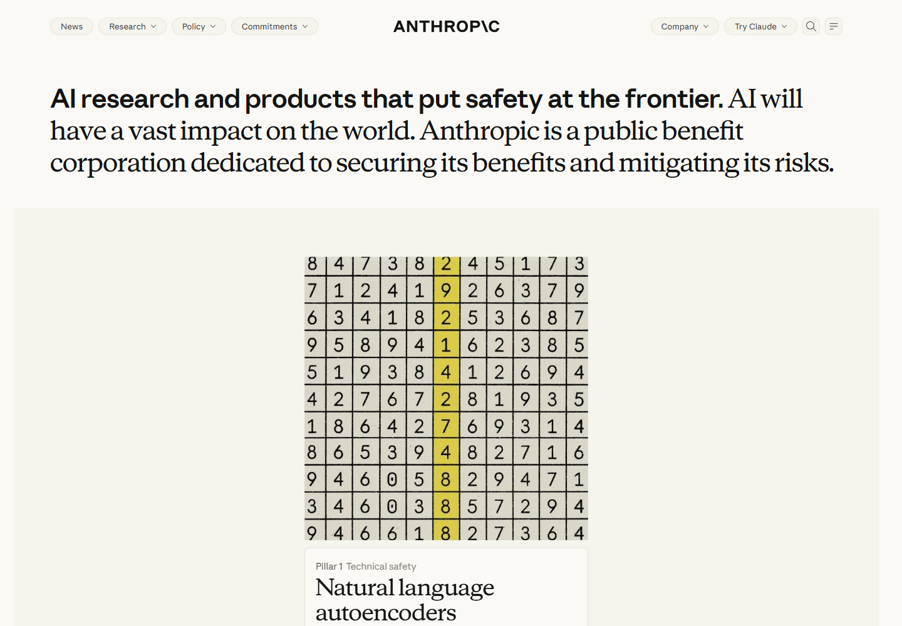

主张段落混合 Sans 与 Serif。下方为动态展示区域的一帧，内容不保证与后续访问一致。

[原站](https://www.anthropic.com/) · [测量记录](../data/pages/anthropic-home.json)

S02 · Claude 产品介绍

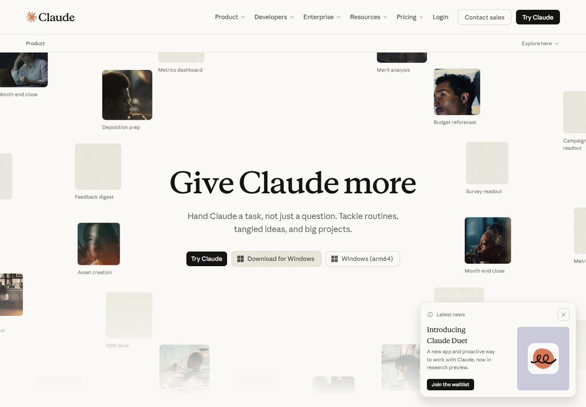

动态首屏中的主标题、主要动作和场景图像。未访问对话页面。

[原站](https://claude.com/product/overview) · [测量记录](../data/pages/claude-product.json)

S03 · Claude 定价

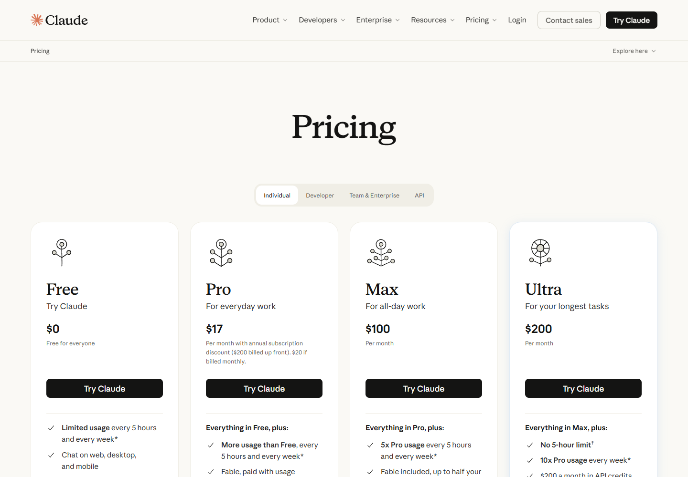

Individual 默认状态；价格只作为界面内容展示，不构成当前价格说明。

[原站](https://claude.com/pricing) · [测量记录](../data/pages/claude-pricing.json)

S04 · Claude 资源中心

浅色网格、衬线大标题、搜索入口和文章卡片。

[原站](https://claude.com/resources) · [测量记录](../data/pages/claude-resources.json)

S05 · Claude Academy 首页

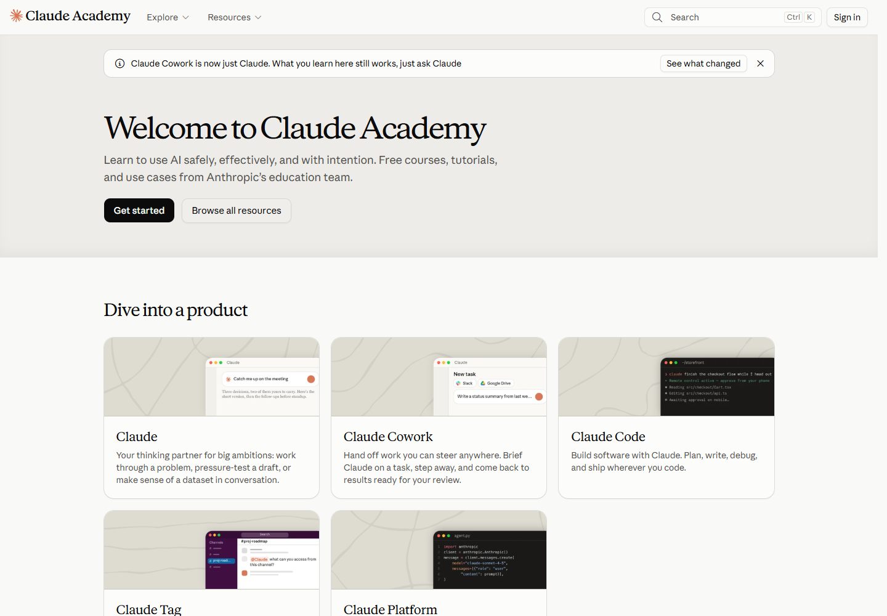

学习入口、课程品牌标题与产品卡片。

[原站](https://academy.claude.com/) · [测量记录](../data/pages/academy-home.json)

S06 · Academy 课程内页

课程目标、课时与目录。视频区域在本次采集时可能尚未加载。

[原站](https://academy.claude.com/courses/ai-fluency-framework-foundations/introduction-to-ai-fluency) · [测量记录](../data/pages/academy-lesson.json)

S07 · Claude Code 文档

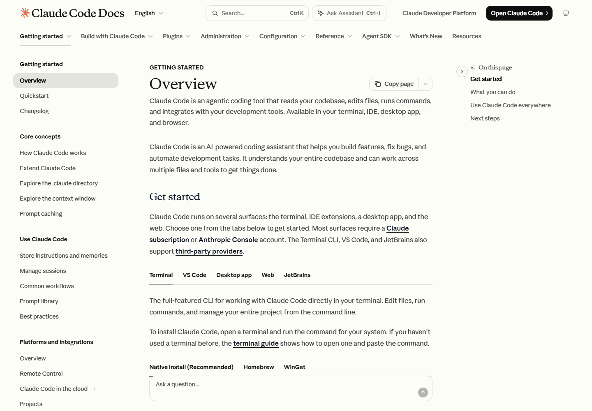

左侧导航、正文和右侧页内目录的桌面结构。

[原站](https://code.claude.com/docs/en/overview) · [测量记录](../data/pages/code-docs.json)

S08 · Claude Platform 文档

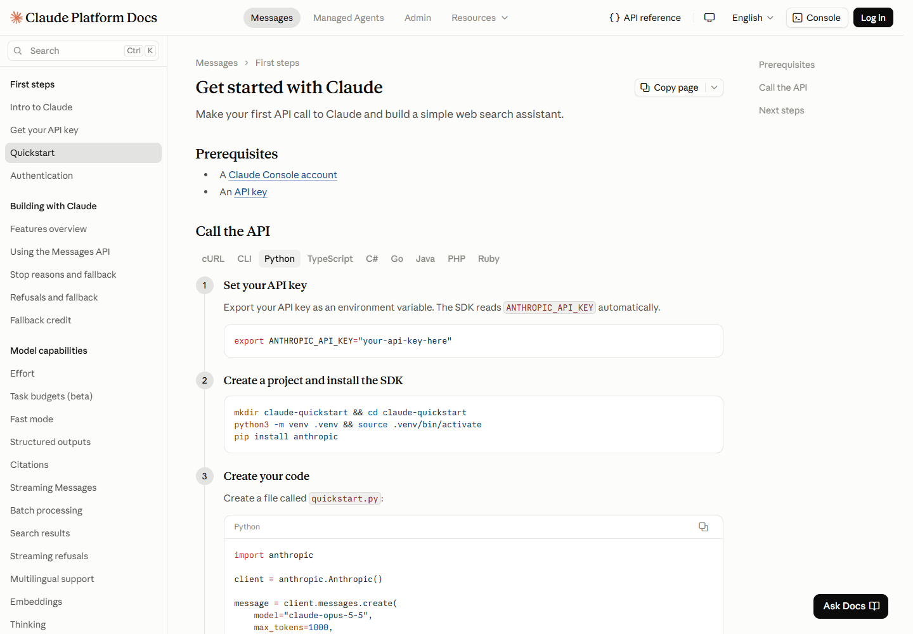

编号步骤、代码和三栏阅读布局。

[原站](https://platform.claude.com/docs/en/get-started) · [测量记录](../data/pages/platform-docs.json)

S09 · Claude 帮助中心

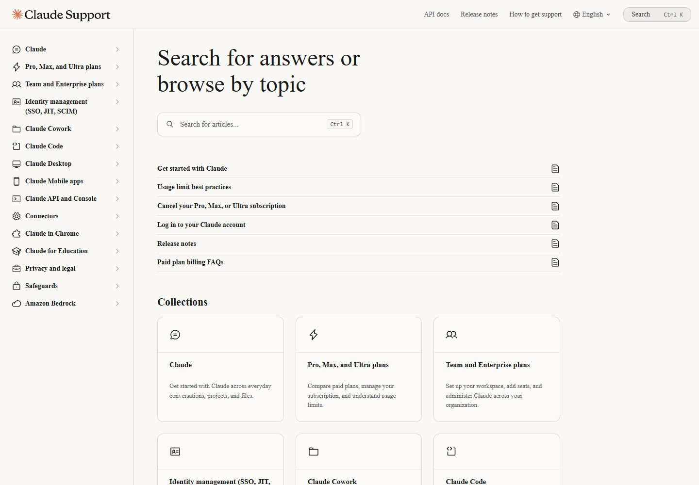

本次字体资源未正常用于抽样文字，实际发生系统字体回退。本图仅用于布局分析。

[原站](https://support.claude.com/en/) · [测量记录](../data/pages/support-home.json)

S10 · Claude 开发者博客

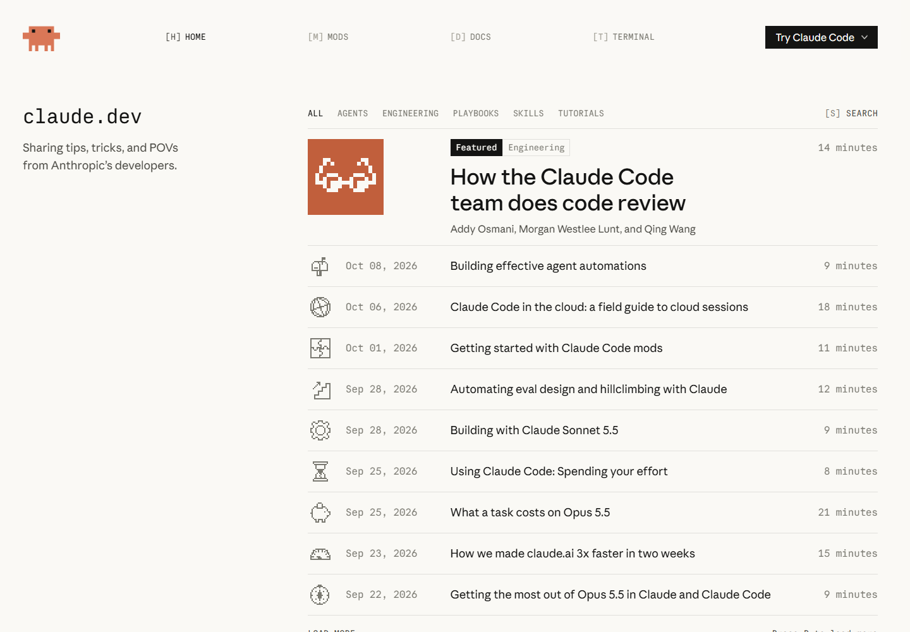

等宽站名、主题筛选、像素图形与文章行。

[原站](https://claude.dev/) · [测量记录](../data/pages/developer-blog.json)

## 窄屏与交互状态

Academy 窄屏首页

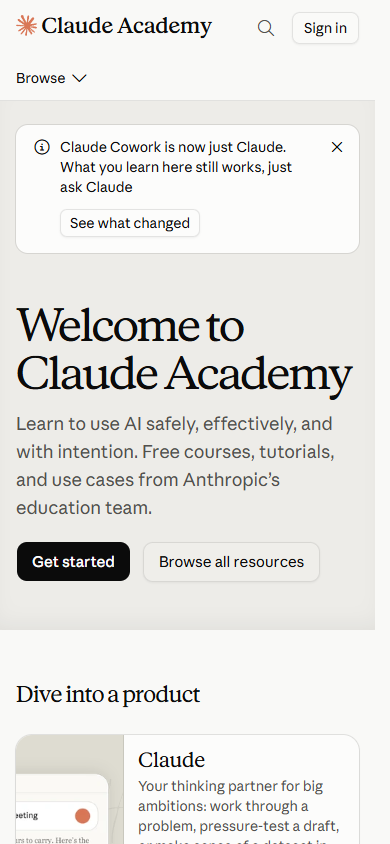

单列入口、标题换行与紧凑导航。桌面浏览器缩窄视口，并非真实手机测试。

[核验记录](../data/pages/academy-home-mobile.json)

Code Docs 窄屏

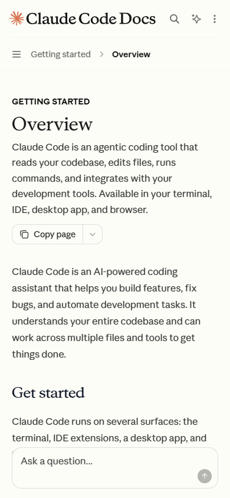

侧边导航收起，正文成为主要阅读区域。

[核验记录](../data/pages/code-docs-mobile.json)

定价切换到 Team & Enterprise

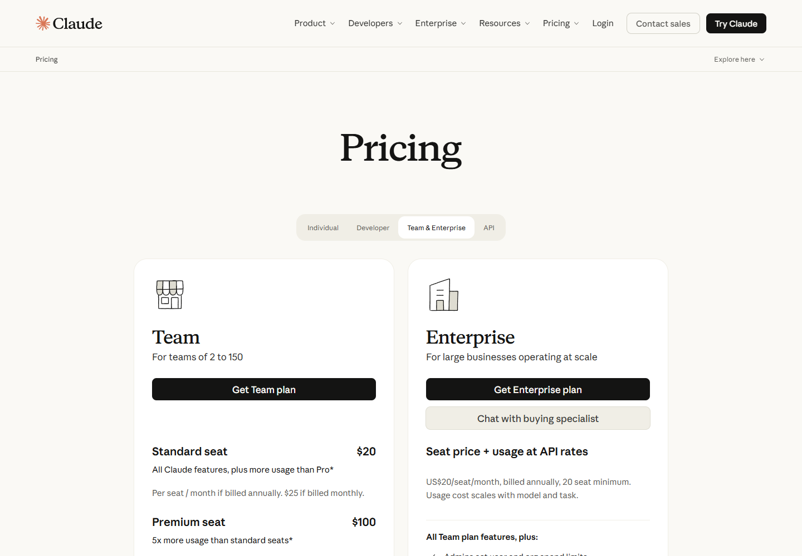

实际选择对应标签后的公开页面，没有进入购买流程。

[核验记录](../data/interaction-checks.json)

课程文字稿状态

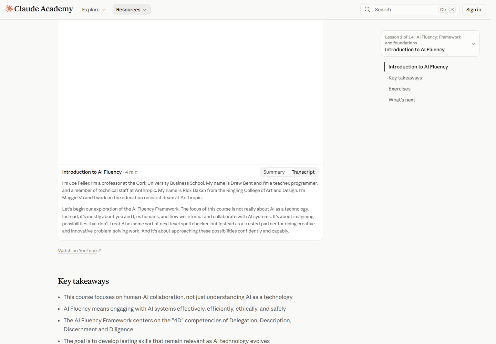

已选择 Transcript。视频区域的空白属于本次加载状态。

[核验记录](../data/interaction-checks.json)

Code Docs 代码区

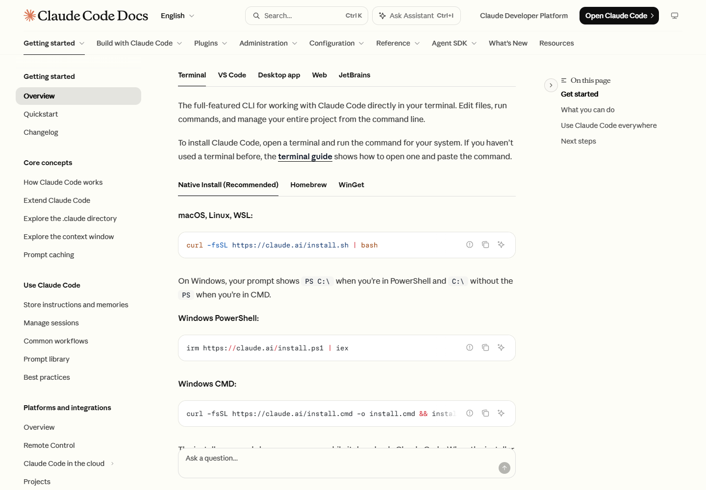

滚动到命令示例，核对 Paper Mono 的实际渲染。没有执行命令。

[核验记录](../data/interaction-checks.json)

## 原创示意图

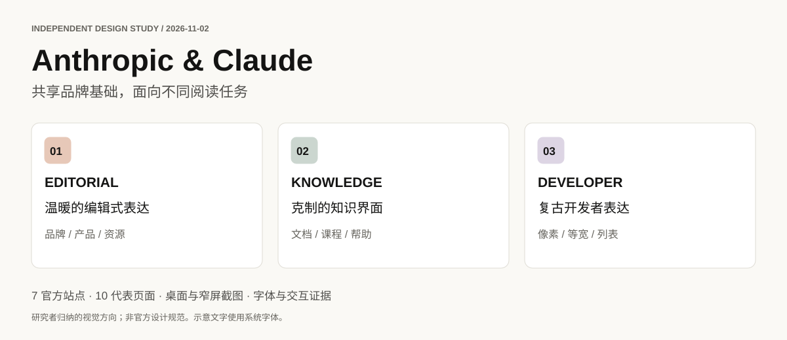

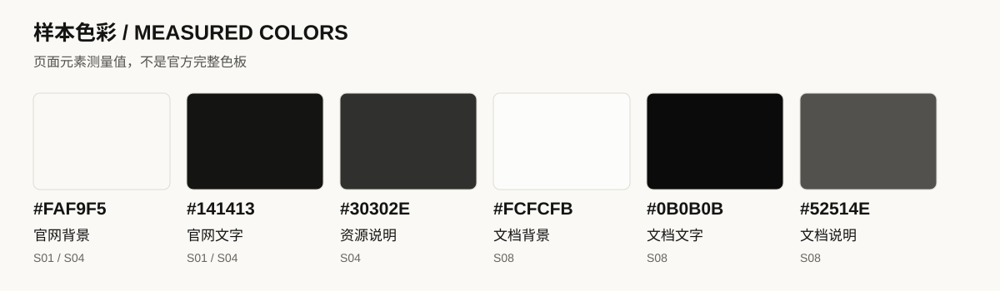

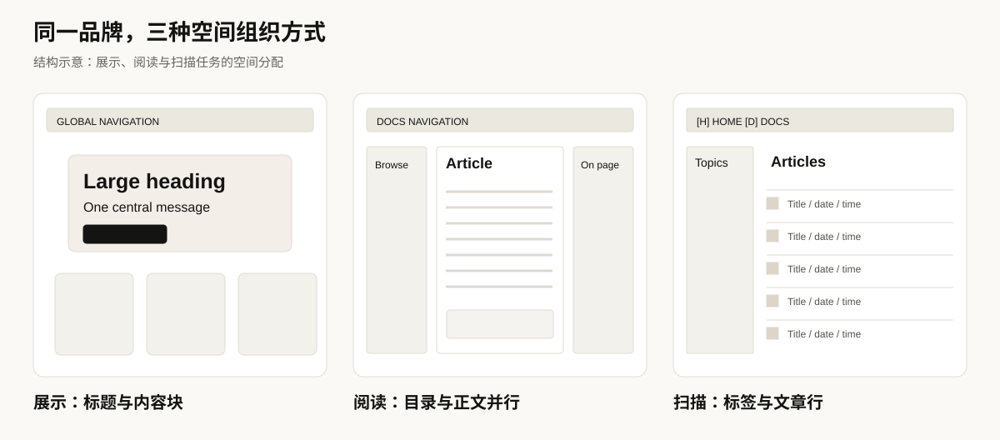

示意图由本项目绘制，用于解释研究结论，不是 Anthropic 官方素材，也不是品牌字体的字样样张。

[下一章：方法与证据](07-methodology-and-sources.md)
