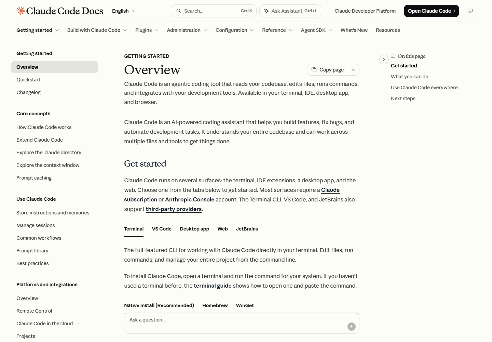
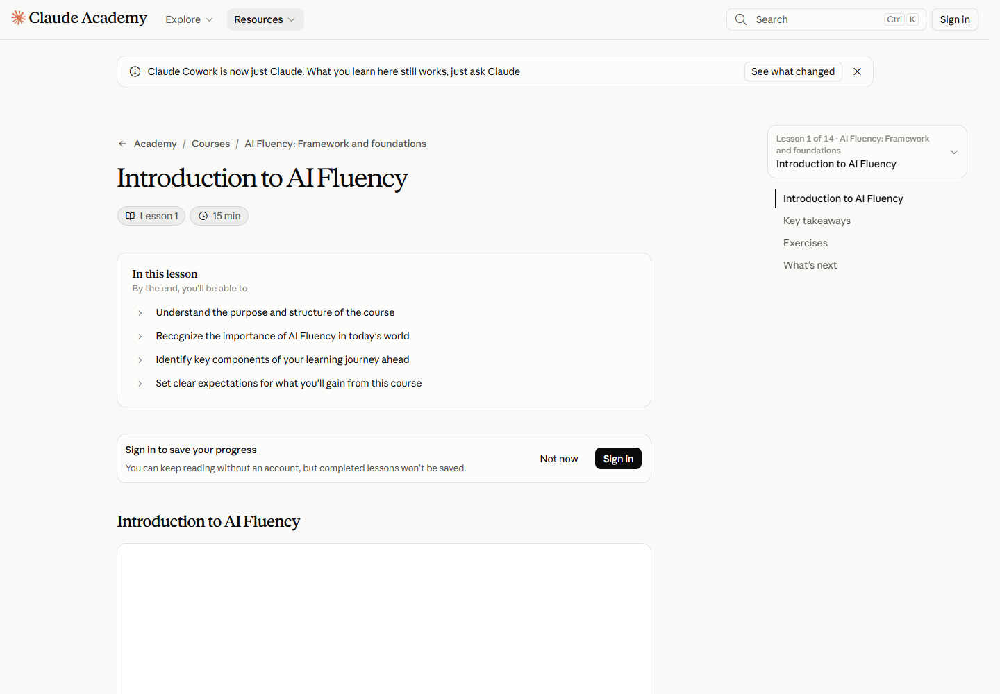

# 09 页面拆解：从视线到行动

**中文** · [English](en/09-page-anatomy.md)

[返回总览](../README.md) · [上一章：应用指南](08-application-guide.md) · [下一章：跨站矩阵](10-cross-site-matrix.md)

把一页拆成区域，可以看见字体、留白与组件怎样共同安排阅读。下面选择资源中心、技术文档与课程三个场景，沿着“先看什么—怎样定位—接下来做什么”逐步分析。

## 资源中心：从内容印象进入检索

| 区域 | 画面中的处理 | 阅读与操作的关系 |
|---|---|---|
| ① 顶部两层导航 | 第一层是产品与公司入口，第二层是资源类型 | 全站去向与当前内容分类分别占据一层 |
| ② 外围文章卡片 | 卡片带有标题、类型、日期或主题，部分延伸到面板边缘 | 进入搜索前先展示内容范围，给浏览型读者提供线索 |
| ③ 中央标题与说明 | 72px 衬线标题配合 23px 说明，周围保留空白 | 页面主题形成明显的视觉中心 |
| ④ 标题下方搜索 | 输入框与快捷键提示放在说明之后 | 从了解页面用途自然进入查找内容 |
| ⑤ 浅网格与边框 | 面板底色 #F5F4ED，分隔线对比度较轻 | 把卡片、标题和搜索放在共同的视觉背景上 |

**阅读顺序：** 识别资源中心 → 理解内容范围 → 浏览文章或进入搜索。中央内容与外围卡片支持两条路径：带着问题来的读者可以直接查找，探索型读者可以先扫描标题。

**可复用的组合：** P02 分类栏 + P05 搜索 + P09 大标题首屏 + P10 卡片网格。用于自己的资源库时，先确定分类与检索入口，再决定外围内容需要多少视觉分量。

[原站 S04](https://claude.com/resources) · [字体、尺寸与色值](../data/pages/claude-resources.json)

## 技术文档：同时回答三个位置问题

| 区域 | 画面中的处理 | 对应问题 |
|---|---|---|
| ① 顶部工具区 | 搜索、文档分类与站点入口并列 | 我该进入哪一类文档？ |
| ② 左侧导航树 | 分组标题和文章入口，当前 Overview 行有底色 | 我在整个文档体系的哪里？ |
| ③ 中央正文 | 标题、介绍、Get started 和安装选项顺序展开 | 当前任务怎样开始？ |
| ④ 右侧页内目录 | 列出当前文章的小节 | 这篇文章有哪些部分？ |
| ⑤ 平台与安装方式切换 | Terminal、VS Code 等平台选项位于对应说明之前 | 哪段内容适用于我的环境？ |

这里的标题为 36px，正文为 16px。标题建立层级，正文提供连续阅读空间，左右两侧则承担不同尺度的定位。窄屏中主标题变为 30px，正文仍为 16px，导航改为紧凑入口。

### 与 Platform 文档并排看

| 项目 | Claude Code 文档 | Claude Platform 文档 |
|---|---|---|
| 桌面结构 | 导航树、正文、页内目录 | 导航树、正文、页内目录 |
| 抽样主标题 | 36px / 40px 行高 | 26.25px / 32.8125px 行高 |
| 标题字体 | Anthropic Serif Display | Anthropic Serif |
| 代码字体 | Paper Mono | Anthropic Mono |
| 起步内容的组织 | 平台及安装方式切换 | 编号步骤与代码示例 |
| 共同的设计逻辑 | 将定位、说明与执行入口放在相邻区域 | 将定位、说明与执行入口放在相邻区域 |

**可复用的组合：** P04 侧边导航与目录 + P07 内容切换 + P19 代码块与复制。Platform 进一步使用 P15 编号步骤组织起步流程。

[Code Docs S07](https://code.claude.com/docs/en/overview) · [Platform S08](https://platform.claude.com/docs/en/get-started) · [Code 测量](../data/pages/code-docs.json) · [Platform 测量](../data/pages/platform-docs.json)

## 课程内页：先建立学习预期

*采集时下方视频区域尚未显示内容，标题、学习目标和章节目录可见。*

| 区域 | 画面中的处理 | 对学习的支持 |
|---|---|---|
| ① 面包屑 | Academy、Courses 与课程名按层级连接 | 将单节内容放回课程体系 |
| ② 标题与课时 | 衬线标题下方显示 Lesson 1 和 15 min | 同时说明主题、位置与预计投入 |
| ③ 学习目标框 | “In this lesson” 单独成组，目标逐条排列 | 在进入主体前建立阅读预期 |
| ④ 右侧章节 | 当前课标题、要点、练习与下一步 | 显示本课的内容顺序 |
| ⑤ 内容形式 | 视频区域与文字稿切换 | 为观看和文字阅读提供入口 |

**阅读顺序：** 确认课程位置 → 看本课目标与投入 → 学习内容 → 查看要点与练习 → 进入后续内容。课时与目标使页面一开始就回答“这节课是否适合现在学”。

**可复用的组合：** P03 面包屑 + P18 重点提示框 + P20 课时与位置提示，再由 P17 内容形式切换与 P16 下一课链接连接学习过程。

[原站 S06](https://academy.claude.com/courses/ai-fluency-framework-foundations/introduction-to-ai-fluency) · [页面测量](../data/pages/academy-lesson.json) · [文字稿切换记录](../data/interaction-checks.json)

## 三种页面的注意力分配

| 页面 | 首先建立什么 | 如何定位 | 接下来做什么 |
|---|---|---|---|
| 资源中心 | 内容范围与主题印象 | 分类、搜索、文章卡片 | 选择一篇内容 |
| 技术文档 | 当前技术任务 | 导航树、页内目录、平台选项 | 阅读步骤并使用代码 |
| 课程内页 | 学习目标与投入 | 课程层级、章节位置 | 学习、练习、继续下一节 |

相同的字体与底色进入这三种结构后，会产生不同的阅读节奏。设计复用时，可先选择需要支持的路径，再搭配合适的标题比例、导航层级和操作入口。

[下一章：跨站设计矩阵](10-cross-site-matrix.md)
