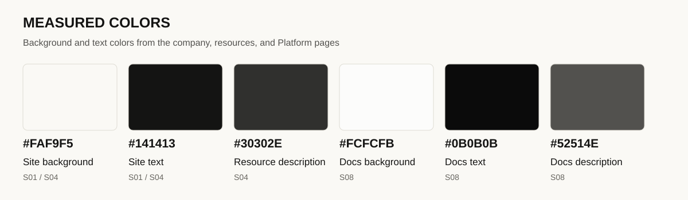
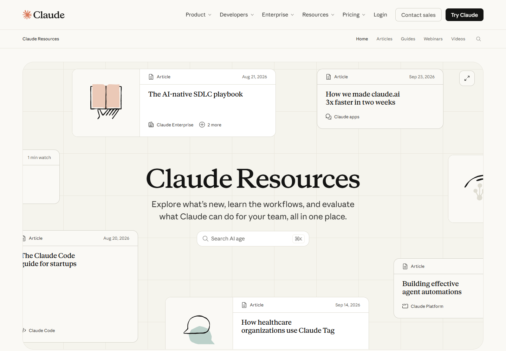
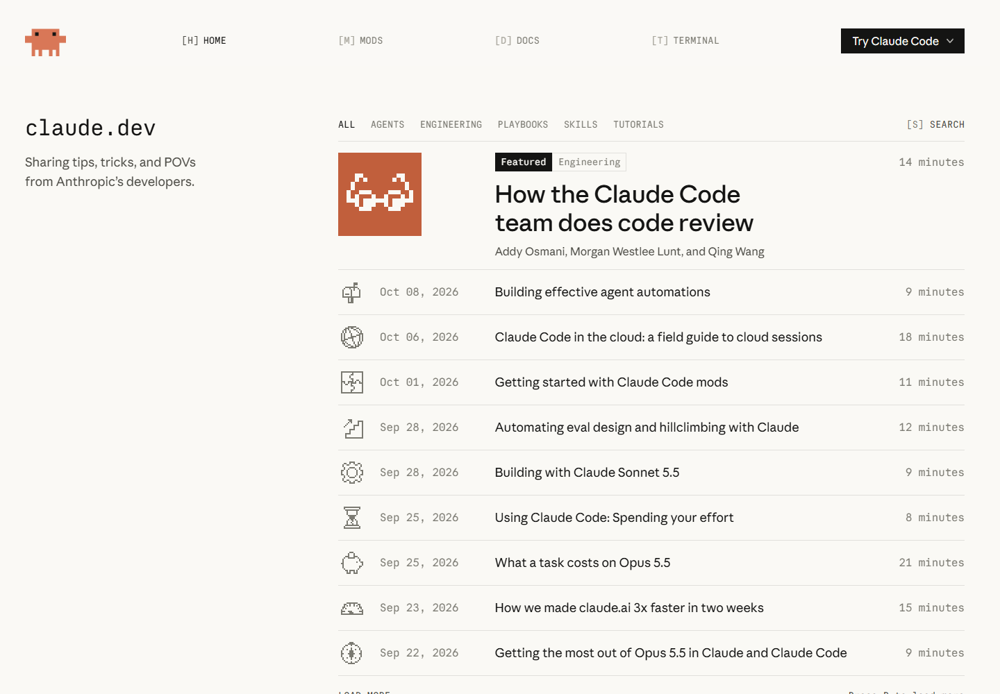

# 01 Visual language

[中文](../01-visual-language.md) · **English**

[Overview](../../README.en.md) · [Next: Typography](02-typography.md)

## What creates a shared identity

Anthropic's public websites repeatedly combine pale backgrounds, dark text, serif headings, and restrained controls. Warm off-white surfaces, expressive letterforms, and generous space create a visual character close to books and magazines.

The density and decoration change with the task. Company pages emphasize narrative and imagery, documentation prioritizes text and orientation, and the developer blog adds monospace lettering and pixel graphics.

## Three visual directions

| Direction | Visible characteristics | Main examples | Design reading |
|---|---|---|---|
| Warm editorial expression | Off-white backgrounds, large serif type, open spacing, illustration, image-and-text composition | Company, product, and resources | Organizes technical product stories like a publication, with room for an introductory narrative |
| Restrained knowledge interfaces | Neutral colors, fine dividers, stable navigation areas, compact controls | Platform, Code Docs, Academy, support | Places finding, reading, and taking the next step at the center |
| Retro developer expression | Monospace labels, pixel graphics, straighter corners, article rows | claude.dev | Gives developer content its own identity while retaining familiar backgrounds and type families |

Sources: [company S01](https://www.anthropic.com/), [resources S04](https://claude.com/resources), [Platform S08](https://platform.claude.com/docs/en/get-started), [developer blog S10](https://claude.dev/).

## The roles of color

*The diagram collects measured background and text colors. The corresponding elements are listed below.*

| Page and element | Measured value | Role |
|---|---|---|
| Company and Claude Resources page background | `#FAF9F5` | Adds a slight warmth to large empty areas |
| Base text on those pages | `#141413` | Gives body text and primary information a dark anchor |
| Resources hero description | `#30302E` | Creates a small difference in emphasis from the heading |
| Platform documentation background | `#FCFCFB` | Provides a near-white surface for dense reading |
| Platform base text | `#0B0B0B` | Supplies the main dark tone for text and controls |
| Platform introductory description | `#52514E` | Separates supporting text from the heading |

Evidence: [S01 measurements](../../data/pages/anthropic-home.json), [S04 measurements](../../data/pages/claude-resources.json), [S08 measurements](../../data/pages/platform-docs.json).

Color also has distinct roles within a page. The orange-brown brand mark provides recognition, pale pink and green enrich illustrations, and syntax colors help distinguish code structure.

## Space and visual rhythm

*Figure 1 · Claude Resources · 1440 × 1000 · [Source S04](https://claude.com/resources).*

The opening screen has three layers. Peripheral cards suggest the range of content; the central heading and description establish the topic; the search field turns attention into an available action. A faint grid connects the composition without dominating the text.

Documentation assigns more space to navigation, articles, and code, creating a tighter reading rhythm. **Space follows the page's task:** the resources hero isolates a topic, while documentation separates navigation, text, and supporting tools.

## Illustrations, icons, and imagery

| Form | Visible treatment | Role in reading |
|---|---|---|
| Line illustrations | Outlines of books, people, or objects with soft areas of color | Distinguish content and break up large stretches of text |
| Pixel graphics | Characters and article imagery on the developer blog | Establish a technical, game-influenced tone |
| Product demonstrations | Tasks and outcomes on the product page | Connect abstract capabilities to concrete situations |
| Small interface icons | Search, copy, contents, and arrows | Identify actions; some sites use the Anthropicons font |

*Figure 2 · claude.dev · [Source S10](https://claude.dev/). Pixel imagery and monospace labels work together as its visual identity.*

## Borders, corners, and shadows

Cards often use pale borders and small background changes to form groups; primary buttons use solid dark fills. Resource cards, pricing cards, code boxes, and blog controls use different corner shapes and sizes for their respective tasks.

The recurring division of labor is clear: **borders group content, fills establish action priority, and space expresses relationships between sections.**

[Next: Typography](02-typography.md)
