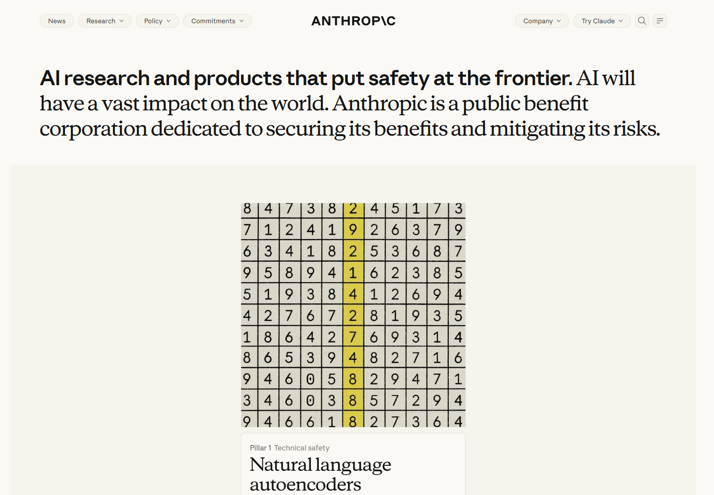
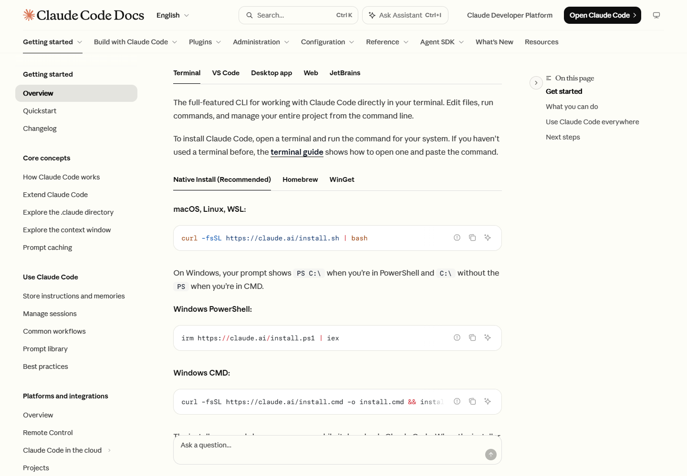

# 02 Typography

[中文](../02-typography.md) · **English**

[Overview](../../README.en.md) · [Previous: Visual language](01-visual-language.md) · [Next: Page patterns](03-page-patterns.md)

## Five principal names, four core families

The principal text fonts below were checked against page styles, loaded font records, and the fonts actually rendering sampled text.

| Name | Category | Main role | Evidence |
|---|---|---|---|
| **Anthropic Sans** | Sans serif | Body text, navigation, buttons, card descriptions | [S04](../../data/pages/claude-resources.json), [S05](../../data/pages/academy-home.json), [S08](../../data/pages/platform-docs.json) |
| **Anthropic Serif** | Serif | Brand headings, page headings, some card titles | [S01](../../data/pages/anthropic-home.json), [S04](../../data/pages/claude-resources.json), [S05](../../data/pages/academy-home.json) |
| **Anthropic Serif Display** | Display serif variant | Claude Code documentation headings | [S07](../../data/pages/code-docs.json) |
| **Anthropic Mono** | Monospace | Platform code, developer blog name and metadata | [S08](../../data/pages/platform-docs.json), [S10](../../data/pages/developer-blog.json) |
| **Paper Mono** | Monospace | Code blocks in Claude Code documentation | [S07](../../data/pages/code-docs.json), [code verification](../../data/interaction-checks.json) |

This gives **five principal names**, or **four core families** when Serif Display is grouped with Serif. Weights, italics, variable versions, and fallback aliases are grouped with their corresponding families.

## Three typographic roles

**Headings establish tone, body text supports reading, and monospace text expresses technical structure.** A type category can also cross roles: the company homepage combines sans and serif text in one heading, while the developer blog uses monospace for its name.

*Figure 3 · [Company homepage S01](https://www.anthropic.com/). The opening of the main statement uses sans serif; the longer continuation uses serif. The area below shows one frame of a dynamic presentation.*

Changes in letterform and weight bring a short claim and a longer explanation into one composition. The browser's rendering records identify both Sans and Serif within that heading.

The developer blog uses Anthropic Mono for its name, connecting the site's identity with the technical tone of its categories and dates.

## Measured type hierarchy

These measurements use a **1440 × 1000** desktop viewport. Size and line height are in CSS pixels.

| Page and role | Size | Line height | Weight | Source |
|---|---:|---:|---:|---|
| Claude Resources main heading | 72 | 79.2 | 500 | [S04](../../data/pages/claude-resources.json) |
| Resources hero description | 23 | 34.5 | 400 | [S04](../../data/pages/claude-resources.json) |
| Pricing main heading | 64 | 70.4 | 500 | [S03](../../data/pages/claude-pricing.json) |
| Academy home main heading | 48 | 52.8 | 400 | [S05](../../data/pages/academy-home.json) |
| Academy home description | 18 | 28 | 400 | [S05](../../data/pages/academy-home.json) |
| Academy lesson heading | 36 | 54 | 400 | [S06](../../data/pages/academy-lesson.json) |
| Code Docs main heading | 36 | 40 | 400 | [S07](../../data/pages/code-docs.json) |
| Code Docs introduction | 16 | 26.4 | 400 | [S07](../../data/pages/code-docs.json) |
| Code Docs code | 14 | 24 | 400 | [S07](../../data/pages/code-docs.json) |
| Platform documentation heading | 26.25 | 32.8125 | 520 | [S08](../../data/pages/platform-docs.json) |
| Developer blog name | 31.5 | 34.65 | 400 | [S10](../../data/pages/developer-blog.json) |

Marketing and resource entrances use larger headings; documentation makes more room for continuous text. Resources uses a 72px heading, compared with 26.25px on the sampled Platform page. The table retains actual variable-font weights, including 520, to preserve these differences.

## Two documentation sites, two code fonts

*Figure 4 · [Code Docs S07](https://code.claude.com/docs/en/overview). Paper Mono in this code area differs from Anthropic Mono in Platform documentation.*

Both sites separate natural language from code. The transferable pattern is the clear boundary between the two, with copy controls and platform choices close to the content they affect.

## Declared, loaded, and rendered fonts

| Layer | What is checked | Evidence |
|---|---|---|
| Declaration | Preferred and fallback fonts assigned to an element | Element styles and font rules |
| Loading | Font resources loaded by the browser | Font loading records |
| Rendering | The source of the glyphs in sampled text | Browser font records for the element |

**The support center's declaration differs from its captured rendering.** It declares aliases for Anthropic Sans and Anthropic Serif, plus JetBrains Mono for a keyboard hint. In the captured sample, headings and body text fell back to Times New Roman, and the hint fell back to Consolas. The screenshot shows this fallback state.

JetBrains Mono is therefore recorded as a local declaration, and Times New Roman and Consolas as fallback fonts. They are separate from the core-font count above. See `renderedFonts` and `fontRuleSources` in [S09](../../data/pages/support-home.json).

## Aliases and non-text fonts

| Name in the sample | Treatment in the study |
|---|---|
| `anthropicSans`, `anthropic-sans`, `Anthropic Sans` | Anthropic Sans |
| `anthropicSerif`, `anthropic-serif` | Anthropic Serif |
| `anthropicMono`, `Anthropic Mono` | Anthropic Mono |
| Names containing Fallback, and backup fonts such as Arial or Georgia | Separate from core brand-font counts |
| `Anthropicons-Variable` | Icon font, separate from text fonts |
| Text, Web, Variable, Light, and similar file descriptors | Retained in evidence and grouped with the corresponding family |

## Applying the typography to Chinese

The source samples are predominantly English. Chinese typography needs its own character-coverage check and real content to assess punctuation, weight, mixed scripts, and line breaks. This preserves hierarchy while adapting to different character density and reading rhythms.

[Next: Eight page patterns](03-page-patterns.md)
