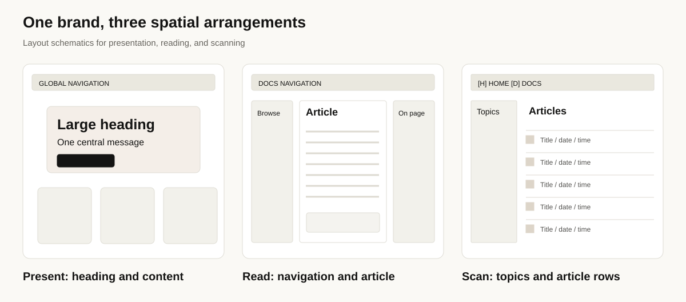
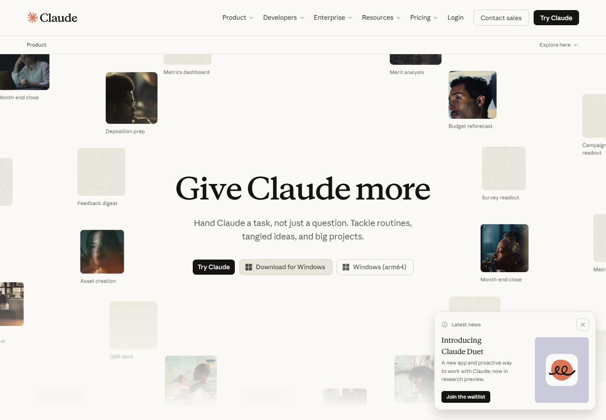
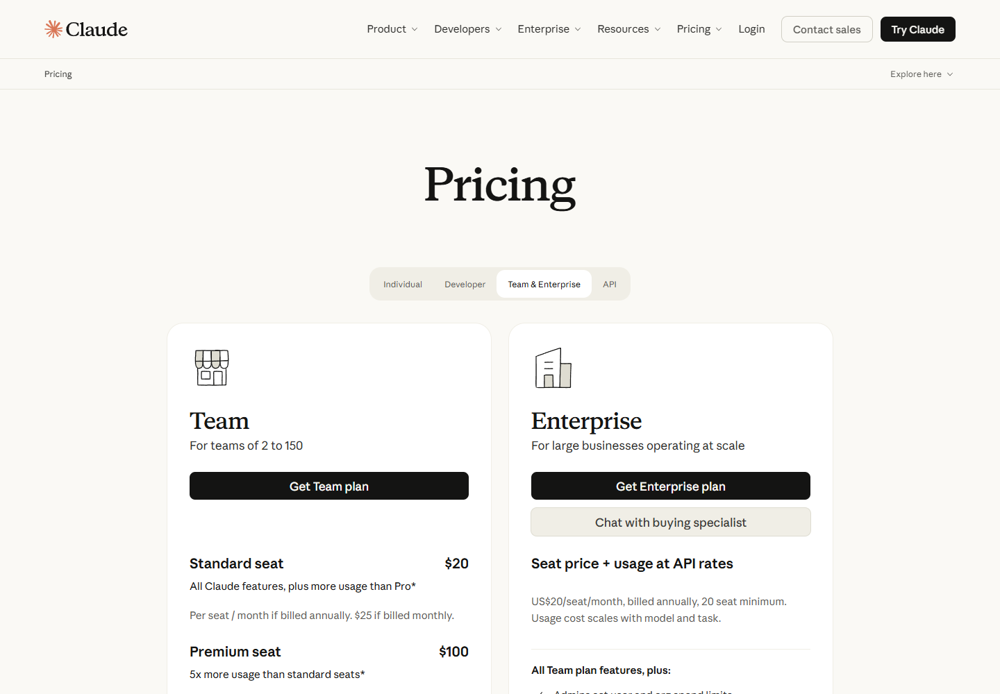
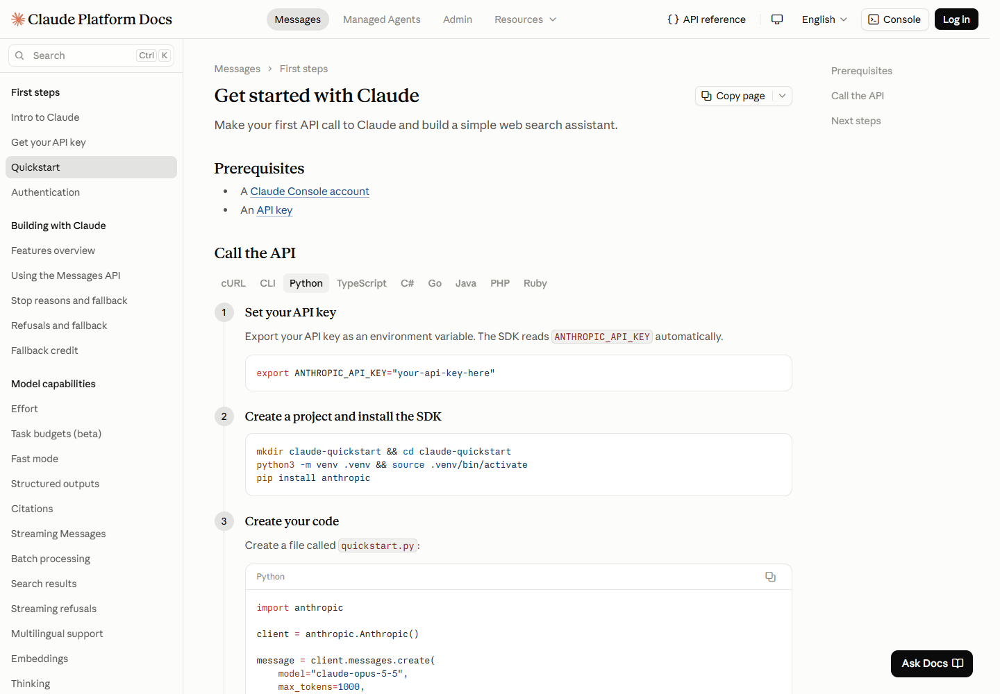

# 03 Eight page patterns

[中文](../03-page-patterns.md) · **English**

[Overview](../../README.en.md) · [Previous: Typography](02-typography.md) · [Next: Components](04-components.md)

## Grouping pages by task

Documentation on different domains can share a structure, while one Claude domain can contain product, pricing, and resource pages. These eight categories follow the reader's main task and show how content and actions are arranged around it.

*A layout comparison: presentation pages, reading pages, and article lists assign space differently.*

## At a glance

| Type | Reader's main question | Structure | Sample |
|---|---|---|---|
| 1 Company and brand | What does this company focus on? | Statement, highlights, articles, company navigation | [S01](https://www.anthropic.com/) |
| 2 Product introduction | What can this product help me do? | Heading and action, scenarios, capability explanations, FAQ | [S02](https://claude.com/product/overview) |
| 3 Pricing comparison | Which plan fits me? | Audience selection, plan cards, comparison, explanations | [S03](https://claude.com/pricing) |
| 4 Resource library | Where is the content I need? | Categories, search, filters, cards, topic groups | [S04](https://claude.com/resources) |
| 5 Technical documentation | How do I complete a technical task? | Navigation tree, article, contents, steps, code | [S07](https://code.claude.com/docs/en/overview), [S08](https://platform.claude.com/docs/en/get-started) |
| 6 Course learning | What should I learn, and what comes next? | Learning routes, goals, duration, chapters, video and text | [S05](https://academy.claude.com/), [S06](https://academy.claude.com/courses/ai-fluency-framework-foundations/introduction-to-ai-fluency) |
| 7 Help knowledge base | How do I resolve this problem? | Search, topics, common questions, article collections | [S09](https://support.claude.com/en/) |
| 8 Developer publication | What experience is worth reading? | Categories, dates, authors, reading time, article rows | [S10](https://claude.dev/) |

## 1 Company and brand

The company homepage begins with a large statement in mixed type, followed by highlighted content and article entrances. It establishes the company's focus before inviting a closer look at particular subjects.

**Design reading:** the statement starts the narrative; selected content and article links extend it into a path from broad impression to specific topics.

## 2 Product introduction

The product page gives prominence to its topic, main actions, and demonstrations, then expands into capabilities and use. Task examples connect the explanation to recognizable situations.

*Figure 5 · [S02](https://claude.com/product/overview). The opening screen includes dynamic content; this is the captured frame.*

**Design reading:** the heading summarizes the use, scenarios show tasks and outcomes, and primary actions provide a way to continue or begin. Together they organize the opening screen.

## 3 Pricing comparison

*Figure 6 · [S03](https://claude.com/pricing). The Team & Enterprise selection displays the relevant plans side by side.*

Readers first choose Individual, Team & Enterprise, or API. Plan cards support an initial assessment, while the feature table supports detailed comparison. These layers answer different questions.

Selecting an audience updates the selected tab and the displayed plans together. [Interaction record](../../data/interaction-checks.json)

## 4 Resource library

Resources includes entrances for home, articles, guides, webinars, and videos, alongside search and filtering. Type, date, and reading information help readers judge relevance before opening the full content.

**Design reading:** a rich opening screen supports exploration, while categories, search, and lists support readers arriving with a particular question.

## 5 Technical documentation

*Figure 7 · [S08](https://platform.claude.com/docs/en/get-started).*

The desktop structure answers three questions at once:

- The left navigation shows where the article sits in the documentation.
- The central text explains how to complete the task.
- The right contents list shows the parts of the current article.

Code Docs and Platform Docs share this reading structure, with different typographic and code details. Code Docs uses Paper Mono for code; Platform uses Anthropic Mono. A shared spatial arrangement accommodates distinct visual treatments.

## 6 Course learning

Academy's homepage helps readers choose a learning route. A lesson combines goals, duration, video, summary or transcript, exercises, and subsequent content. It emphasizes sequence and learning objectives.

*Figure 8 · [S06](https://academy.claude.com/courses/ai-fluency-framework-foundations/introduction-to-ai-fluency). Video content was not visible during capture; goals, text, and navigation were visible.*

Goals explain what the lesson covers, duration helps estimate the commitment, and chapter links establish the reading sequence. The transcript offers another learning entrance; see the [interaction observations](05-ux-and-responsive.md#verified-interactions).

## 7 Help knowledge base

The help center emphasizes search and topic collections, alongside common questions. Its organization supports direct entry into a problem.

**Design reading:** search accepts a specific query, topic collections support browsing, and common questions provide direct entrances. These routes accommodate different levels of problem specificity.

## 8 Developer publication

The developer blog presents titles, dates, and reading time in rows, alongside topic filters and pixel graphics. The repeated rows support scanning and comparison.

Selecting TUTORIALS narrows the list; returning to ALL restores it. The controls and rows form a path from choosing a topic to scanning titles and opening an article. [Interaction record](../../data/interaction-checks.json)

[Next: Twenty component and layout patterns](04-components.md)
