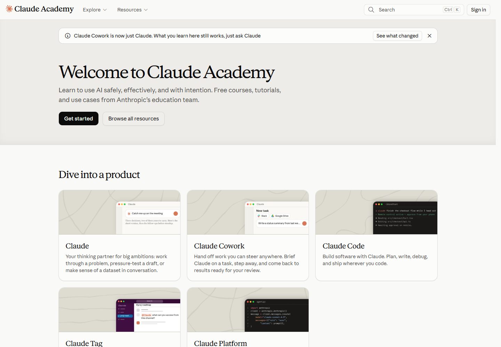

# 04 Twenty component and layout patterns

[中文](../04-components.md) · **English**

[Overview](../../README.en.md) · [Previous: Page patterns](03-page-patterns.md) · [Next: UX and responsive layouts](05-ux-and-responsive.md)

## Organizing components by task

The patterns form five groups of four: navigation, retrieval and switching, content presentation, comparison and steps, and learning and reading aids. Each serves a particular task: a card grid supports browsing; a plan card supports comparing offers.

## Navigation

| ID | Pattern | Sample treatment | Task |
|---|---|---|---|
| P01 | Top dropdown navigation | Entrances grouped by products, developers, and resources | Choose a direction across the site |
| P02 | Secondary category bar | Articles, guides, and video entrances in Resources | Switch categories within a content area |
| P03 | Breadcrumbs | Parent locations in courses and documentation | Understand hierarchy and return upward |
| P04 | Sidebar navigation and contents | Documentation tree, article contents, lesson sections | Locate and move within longer material |

Sources: [resources S04](https://claude.com/resources), [lesson S06](https://academy.claude.com/courses/ai-fluency-framework-foundations/introduction-to-ai-fluency), [docs S07](https://code.claude.com/docs/en/overview).

P01, P02, and P04 handle site direction, the current category, and article position. Top navigation, category bars, and side regions give these different scales of orientation their own spaces.

## Retrieval and switching

| ID | Pattern | Sample treatment | Task |
|---|---|---|---|
| P05 | Site search | Search entrances in resources, help, and docs | Find target content directly |
| P06 | Category filtering | Developer articles filtered by topic | Narrow the candidate set |
| P07 | Tabs and segmented selection | Pricing audiences, code platforms, or languages | Switch related content in context |
| P08 | Expand and collapse | FAQ entries and navigation groups | Reveal detail as needed |

Sources: [pricing S03](https://claude.com/pricing), [Code Docs S07](https://code.claude.com/docs/en/overview), [blog S10](https://claude.dev/). State changes for P06 and P07 appear in the [interaction record](../../data/interaction-checks.json).

Search accepts an open query, filtering constrains a collection, and tabs switch predefined content. Their controls can be compact while retaining these different behaviors.

## Content presentation

| ID | Pattern | Sample treatment | Task |
|---|---|---|---|
| P09 | Large-heading hero | Heading, short explanation, and main action | Establish the page's topic |
| P10 | Card grid | Courses, product entrances, and resources | Browse parallel choices |
| P11 | Article rows | Dates, titles, and reading time arranged in rows | Scan and compare articles |
| P12 | Product demonstration | Visual scenes, tasks, and outcomes | Explain how a capability is used |

Sources: [product S02](https://claude.com/product/overview), [resources S04](https://claude.com/resources), [Academy S05](https://academy.claude.com/), [blog S10](https://claude.dev/).

*Figure 9 · [S05](https://academy.claude.com/). Each card combines a subject, description, and illustration to help readers choose a learning route.*

Cards suit items with distinct descriptions or imagery. Rows suit content with repeated fields that readers want to scan continuously. The choice follows content structure and the comparison task.

## Comparison and steps

| ID | Pattern | Sample treatment | Task |
|---|---|---|---|
| P13 | Plan cards | Name, price, action, and features grouped together | Form an overall impression of a plan |
| P14 | Feature comparison table | The same feature compared across plans | Inspect decision-relevant differences |
| P15 | Numbered steps | Setup and actions connected with sequence numbers | Follow an execution order |
| P16 | Next lesson or next step | A link to subsequent course content | Continue after the current material |

Sources: [pricing S03](https://claude.com/pricing), [lesson S06](https://academy.claude.com/courses/ai-fluency-framework-foundations/introduction-to-ai-fluency), [Platform S08](https://platform.claude.com/docs/en/get-started).

Complete steps connect prerequisites, actions, and results. Useful comparison tables highlight differences that affect a choice. Numbers and tables give those relationships stable structures.

## Learning and reading aids

| ID | Pattern | Sample treatment | Task |
|---|---|---|---|
| P17 | Video and text switching | Lesson summary or transcript entrances | Choose a learning format |
| P18 | Highlighted callout | Goals or important explanations in their own group | Establish expectations before reading |
| P19 | Code block and copy | Commands or code beside a copy control | Prepare content for execution |
| P20 | Duration and position cues | Lesson numbers, duration, or section labels | Judge commitment and current position |

Sources: [lesson S06](https://academy.claude.com/courses/ai-fluency-framework-foundations/introduction-to-ai-fluency), [Code Docs S07](https://code.claude.com/docs/en/overview), [Platform S08](https://platform.claude.com/docs/en/get-started).

Duration communicates commitment, chapter cues communicate position, and adjacent copy controls connect code reading with preparation to use it. These aids stay close to the text.

## Shared expression and local variation

| Recurring expression | Changes with the task |
|---|---|
| Dark primary actions and light secondary surfaces | Corner shape, size, and arrangement of buttons and cards |
| Clear heading and body hierarchy | Serif or monospace heading choices |
| Space or dividers between navigation and text | Top, side, or collapsed navigation |
| A visible distinction between code and prose | Code font, language switching, and code-box details |

Type hierarchy, tonal relationships, and spatial grouping create consistency; corners, sizes, font choices, and navigation placement adapt to the page's purpose.

[Next: UX and responsive observations](05-ux-and-responsive.md)
