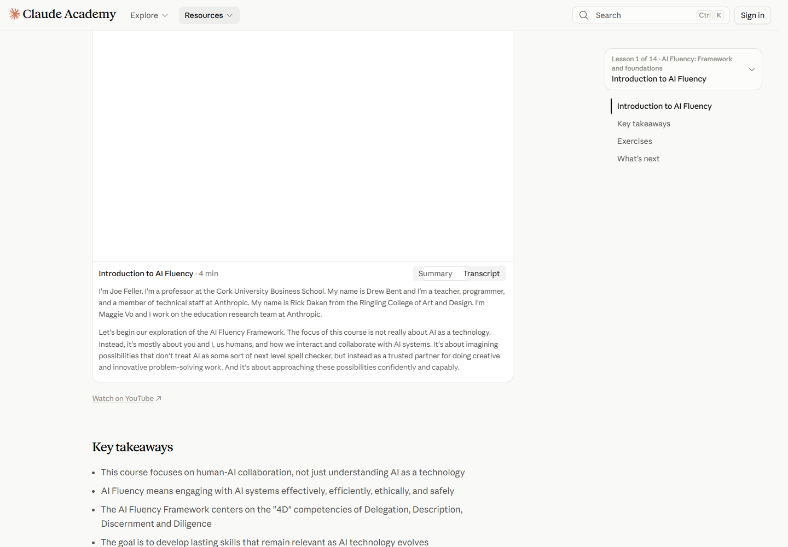
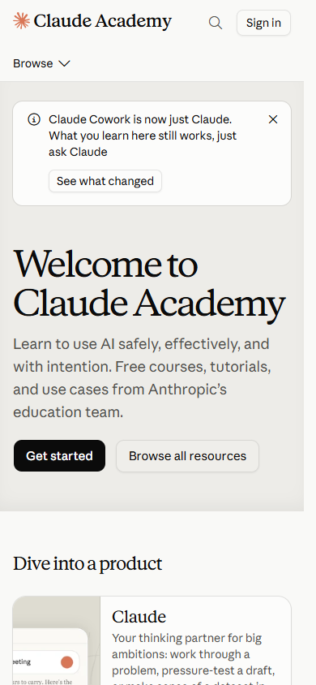
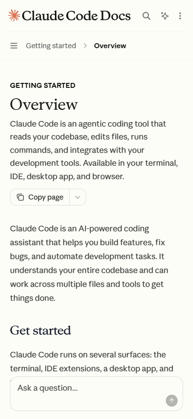

# 05 UX and responsive observations

[中文](../05-ux-and-responsive.md) · **English**

[Overview](../../README.md) · [Previous: Components](04-components.md) · [Next: Screenshot gallery](06-gallery.md)

## Helping readers take the next step

Visual hierarchy works alongside information structure. A large heading attracts attention, but readers also need a next action. A substantial article needs ways to locate sections and return to context.

| Situation | Support in the samples | Design reading |
|---|---|---|
| First encounter with a product | Brief description, scenarios, prominent main action | Establish use before inviting action |
| Comparing plans | Audience selection, plan cards, detailed table | Separate initial assessment from close comparison |
| Finding technical content | Navigation tree, search, page contents | Support browsing and direct location |
| Following instructions | Numbered steps, code, nearby copy controls | Keep explanation and execution material together |
| Learning in sequence | Goals, duration, next lesson | Supply a starting point and a continuing route |

## Verified interactions

These results come from actions on public pages. See [interaction-checks.json](../../data/interaction-checks.json).

| Check | Observed result | Observed element |
|---|---|---|
| Pricing audience selection | Switching Individual to Team & Enterprise displays the corresponding plans | Selected tab state and plan headings |
| Blog topic filter | The list changes from 10 items to 1, then returns to 10 with ALL | Category selection and visible article count |
| Lesson transcript selection | Transcript becomes selected and the state updates | Selected state of the content switch |
| Documentation code font | Sampled code renders with Paper Mono | Text in the code area |
| Resources first keyboard focus | The first Tab reaches Skip to main content | Keyboard entrance past navigation |

*Figure 10 · [Lesson S06](https://academy.claude.com/courses/ai-fluency-framework-foundations/introduction-to-ai-fluency). The video area was blank while loading during capture; the transcript control and lower text were available.*

This lesson offers video and text as two learning formats. Text and chapter navigation remain available while the video resource is not ready.

## Desktop and narrow viewports

<table>
<tr><th>Academy: 390 × 844</th><th>Code Docs: 390 × 844</th></tr>
<tr>
<td></td>
<td></td>
</tr>
</table>

*Figures 11–12 · Both captures use a desktop browser resized to a 390 × 844 viewport.*

| Element | Desktop, 1440px wide | Narrow, 390px wide |
|---|---|---|
| Academy main heading | 48px, line height 52.8px | 44px, line height 48.4px; wraps across lines |
| Academy description | 18px, line height 28px | Remains 18px / 28px |
| Academy content entrances | Multiple card columns | One vertical column with adjusted image/text relationships |
| Code Docs main heading | 36px, line height 40px | 30px, line height 36px |
| Code Docs introduction | 16px, line height 26.4px | Remains 16px / 26.4px |
| Code Docs navigation | Left navigation, central article, right contents | One main reading column with compact navigation entrances |
| Document-wide horizontal overflow | None detected in either sample | None detected in either sample |

Evidence: [Academy desktop](../../data/pages/academy-home.json), [Academy narrow](../../data/pages/academy-home-mobile.json), [Code Docs desktop](../../data/pages/code-docs.json), [Code Docs narrow](../../data/pages/code-docs-mobile.json).

The narrow layout **redistributes space**: some headings shrink, body text retains its size, navigation becomes compact, and cards form a single column. Content priority drives the arrangement.

## Four text contrast checks

Contrast is calculated from the sampled text color and its nearest opaque ancestor background. The Resources hero sits on `#F5F4ED`, inside a page whose outer background is `#FAF9F5`; the calculation uses the panel behind the text.

| Sample | Text | Background | Approximate contrast |
|---|---|---|---:|
| Resources heading | #141413 | #F5F4ED | 16.72 : 1 |
| Resources description | #30302E | #F5F4ED | 11.99 : 1 |
| Platform heading | #0B0B0B | #FCFCFB | 19.17 : 1 |
| Platform description | #52514E | #FCFCFB | 7.73 : 1 |

W3C's minimum is 4.5 : 1 for normal text and 3 : 1 for qualifying large text, with specified exceptions. [W3C contrast explanation](https://www.w3.org/WAI/WCAG22/Understanding/contrast-minimum.html)

All four pairs exceed the normal-text threshold. Both pages use dark headings and slightly lighter descriptions to establish hierarchy while keeping supporting text at a high contrast. [Calculated data](../../data/derived-checks.json) · [Calculation script](../../scripts/analyze.py)

## Turning observations into design decisions

| Design concern | Concrete treatment | Application |
|---|---|---|
| State matches content | Pricing selection updates the corresponding plans | Keep selected styling aligned with displayed content |
| Learning formats are available | A transcript entrance accompanies the lesson | Make alternate content easy to find |
| Narrow layouts preserve reading priority | Body text stays the same size as navigation collapses | Arrange content order before adjusting dimensions |
| Keyboard entry supports the main task | Resources starts focus at a skip link | Provide a direct route into the main content |
| Hierarchy retains clarity | Descriptions are lighter than headings but still high contrast | Check both hierarchy and legibility |

[Next: Screenshot gallery](06-gallery.md)
