# 06 Screenshot gallery

[中文](../06-gallery.md) · **English**

[Overview](../../README.en.md) · [Previous: UX and responsive layouts](05-ux-and-responsive.md) · [Next: Methods and evidence](07-methodology-and-sources.md)

All screenshots were captured on **2026-11-02**. Desktop viewports are **1440 × 1000**, and narrow viewports are **390 × 844**. Expand an entry, then select its image to inspect the original size. Loading and animation states are described with the relevant figure.

## Ten representative pages

S01 · Anthropic company homepage

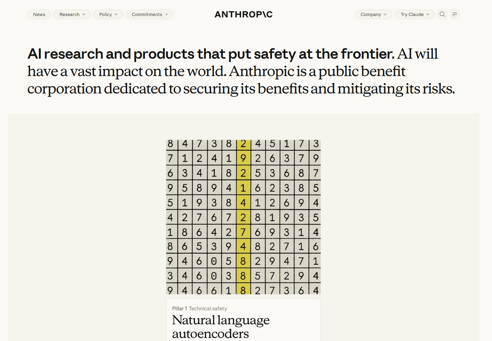

The statement mixes Sans and Serif. The lower region shows a frame from dynamic content.

[Source](https://www.anthropic.com/) · [Measurements](../../data/pages/anthropic-home.json)

S02 · Claude product introduction

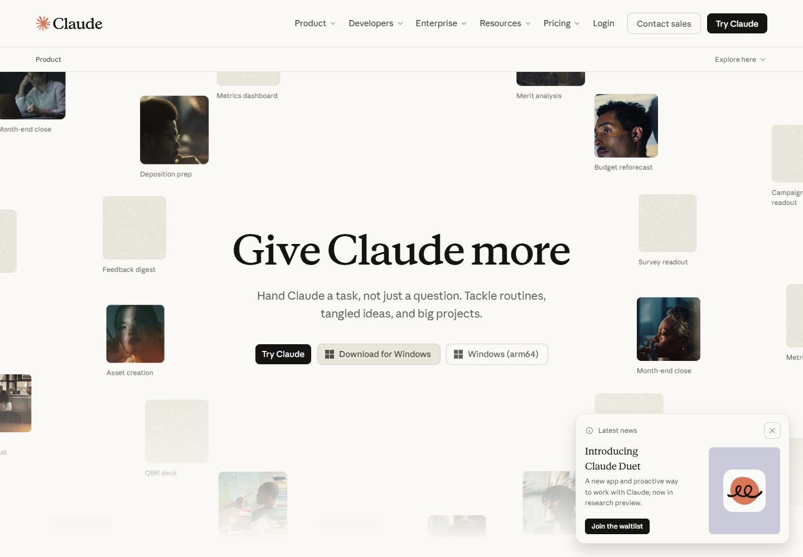

The heading, main actions, and scene imagery introduce product use.

[Source](https://claude.com/product/overview) · [Measurements](../../data/pages/claude-product.json)

S03 · Claude pricing

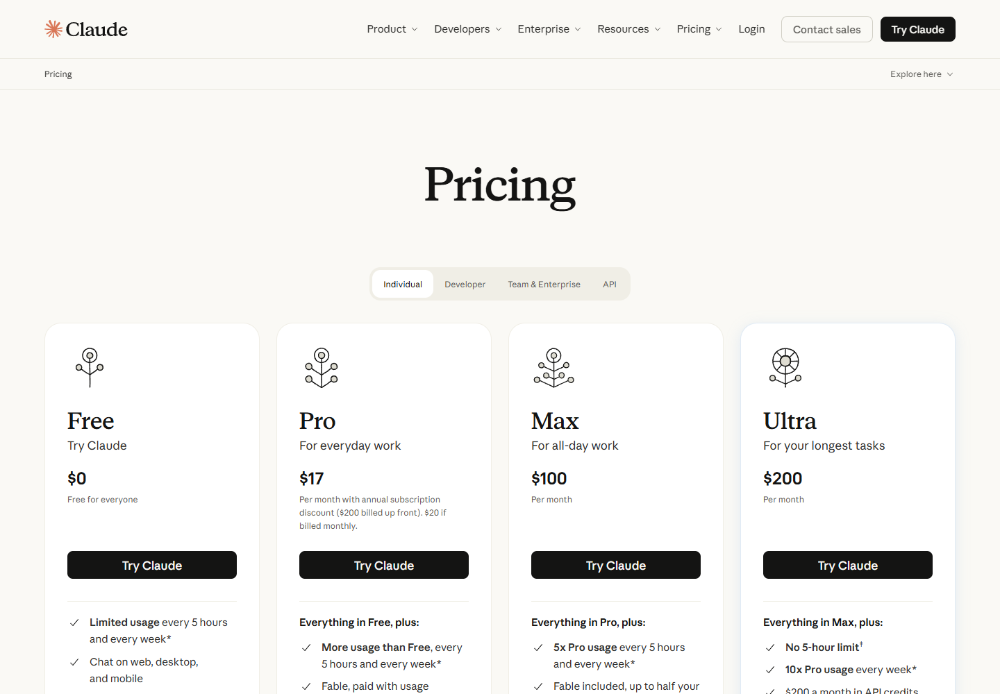

The default Individual state organizes plan names, prices, descriptions, and main actions in columns.

[Source](https://claude.com/pricing) · [Measurements](../../data/pages/claude-pricing.json)

S04 · Claude Resources

A faint grid, large serif heading, search field, and article cards.

[Source](https://claude.com/resources) · [Measurements](../../data/pages/claude-resources.json)

S05 · Claude Academy homepage

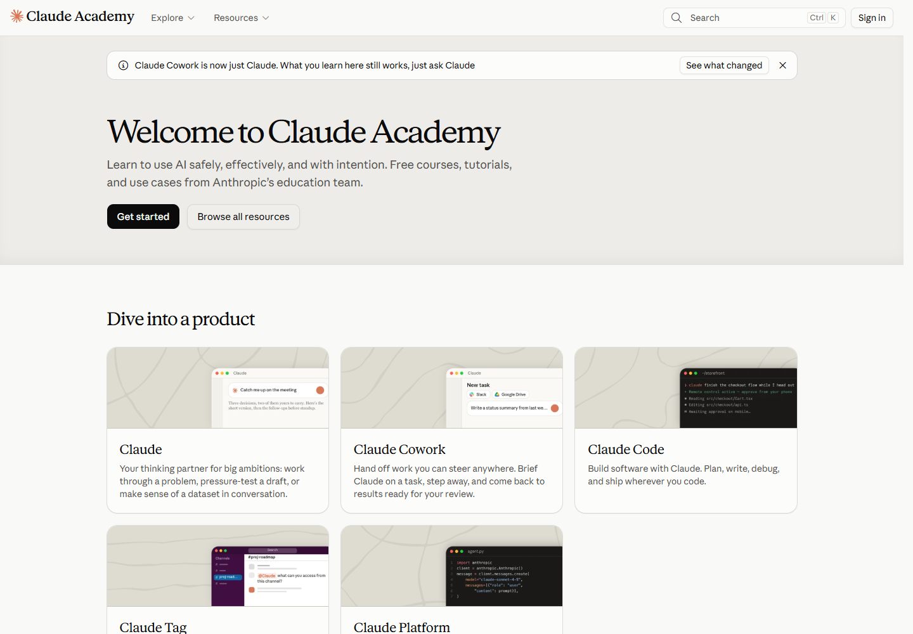

Learning entrances, course branding, and product cards.

[Source](https://academy.claude.com/) · [Measurements](../../data/pages/academy-home.json)

S06 · Academy lesson

Learning goals, duration, and contents. Video content had not appeared during capture.

[Source](https://academy.claude.com/courses/ai-fluency-framework-foundations/introduction-to-ai-fluency) · [Measurements](../../data/pages/academy-lesson.json)

S07 · Claude Code documentation

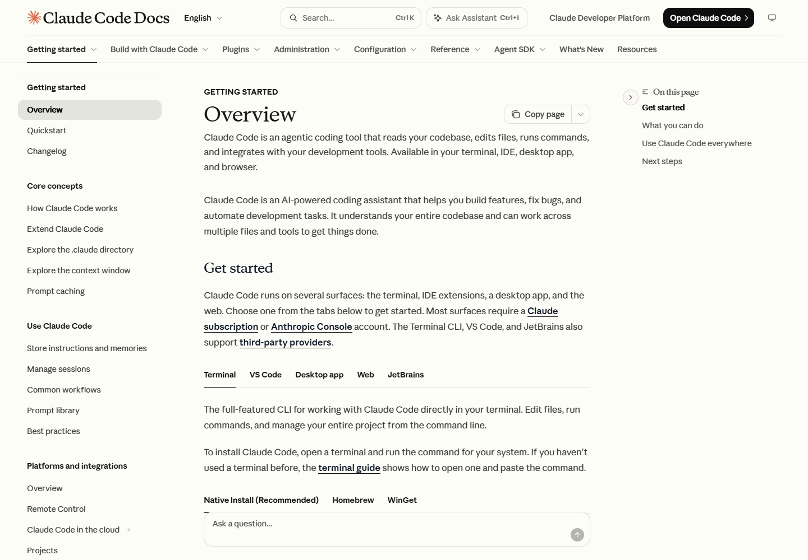

A desktop structure with left navigation, central text, and right page contents.

[Source](https://code.claude.com/docs/en/overview) · [Measurements](../../data/pages/code-docs.json)

S08 · Claude Platform documentation

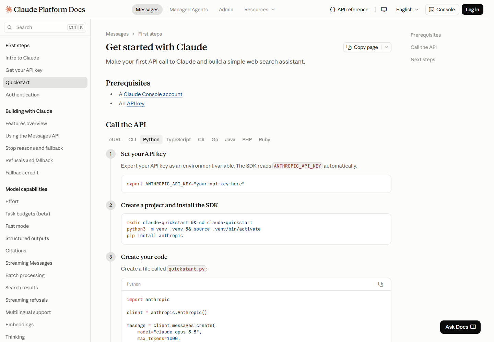

Numbered steps and code within a three-column reading structure.

[Source](https://platform.claude.com/docs/en/get-started) · [Measurements](../../data/pages/platform-docs.json)

S09 · Claude help center

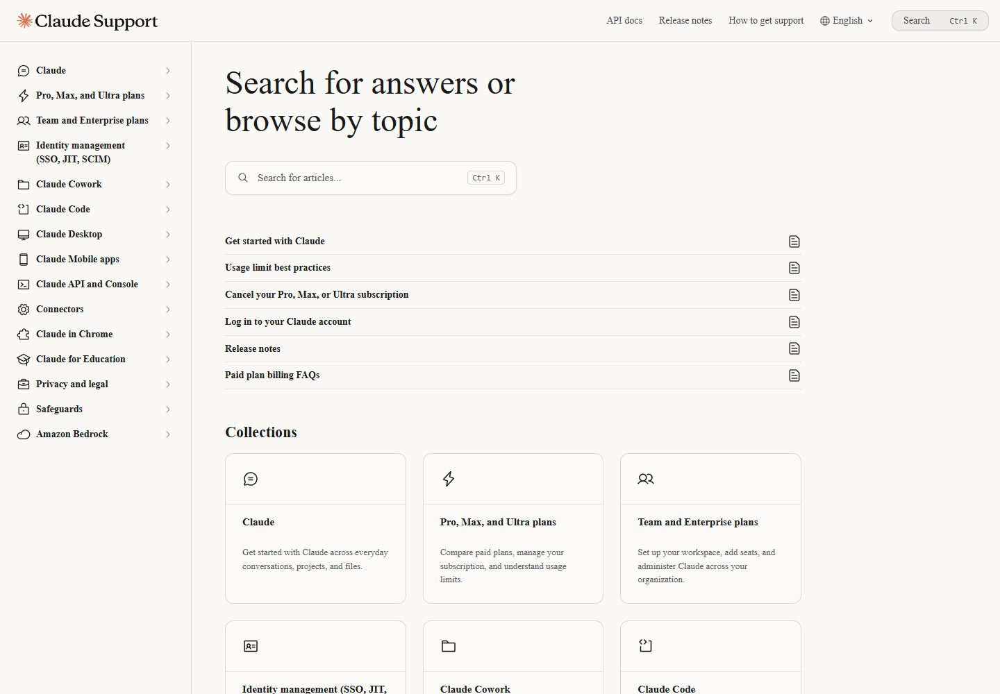

Search and topic collections organize the page. During capture, headings and body text fell back to Times New Roman, and keyboard hints to Consolas. See the [font records](02-typography.md#declared-loaded-and-rendered-fonts).

[Source](https://support.claude.com/en/) · [Measurements](../../data/pages/support-home.json)

S10 · Claude developer blog

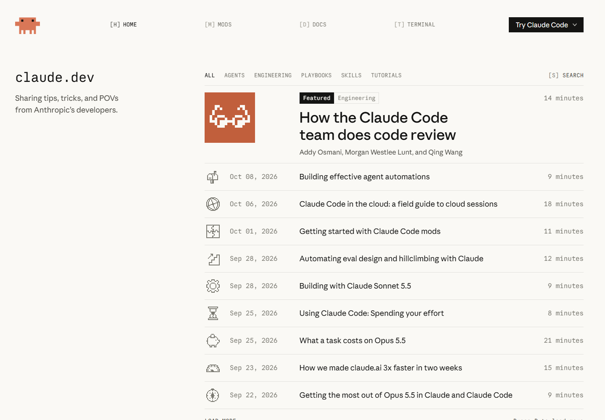

A monospace name, topic filter, pixel imagery, and article rows.

[Source](https://claude.dev/) · [Measurements](../../data/pages/developer-blog.json)

## Narrow viewports and interaction states

Academy at a narrow width

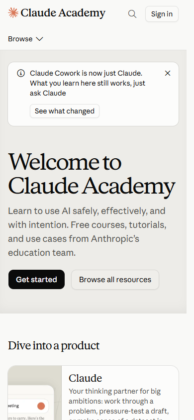

At a 390px-wide desktop-browser viewport, entrances form a single column, the heading wraps, and navigation contracts.

[Record](../../data/pages/academy-home-mobile.json)

Code Docs at a narrow width

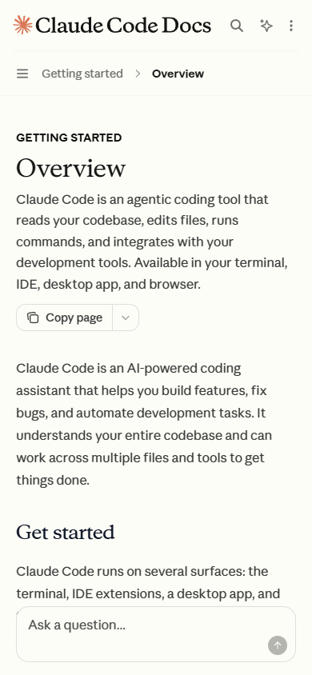

Side navigation collapses and the article becomes the main reading area.

[Record](../../data/pages/code-docs-mobile.json)

Pricing: Team & Enterprise

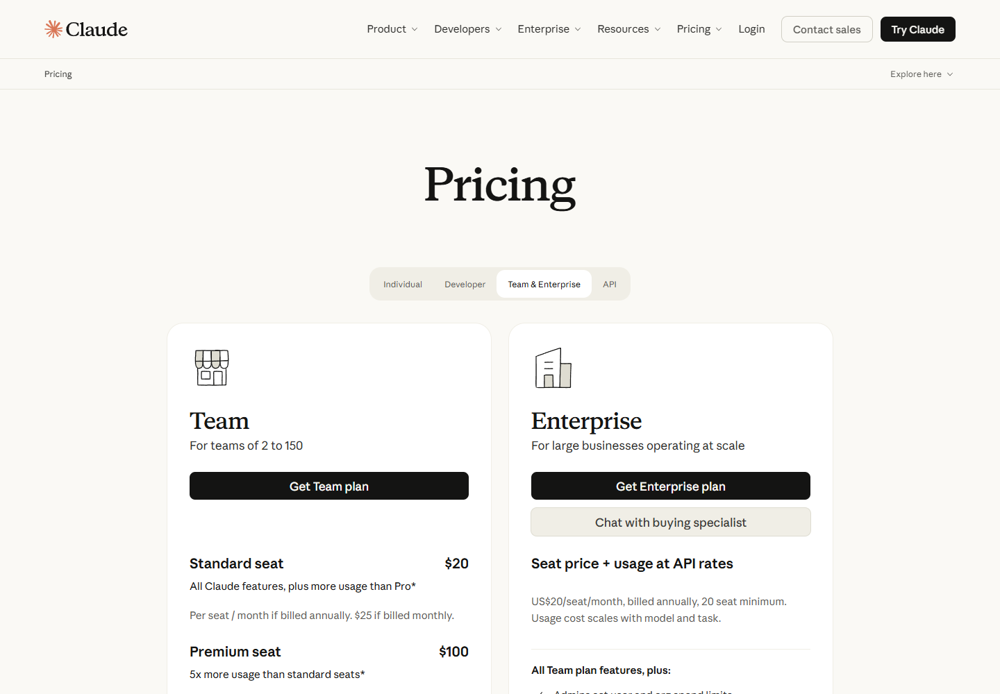

The selected tab corresponds to the Team and Enterprise plans below.

[Record](../../data/interaction-checks.json)

Lesson transcript selected

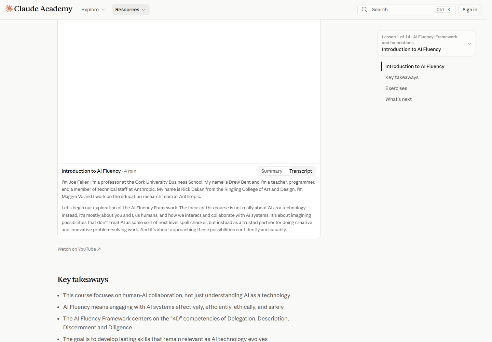

Transcript is selected. The blank video region reflects its loading state during capture.

[Record](../../data/interaction-checks.json)

Code Docs code area

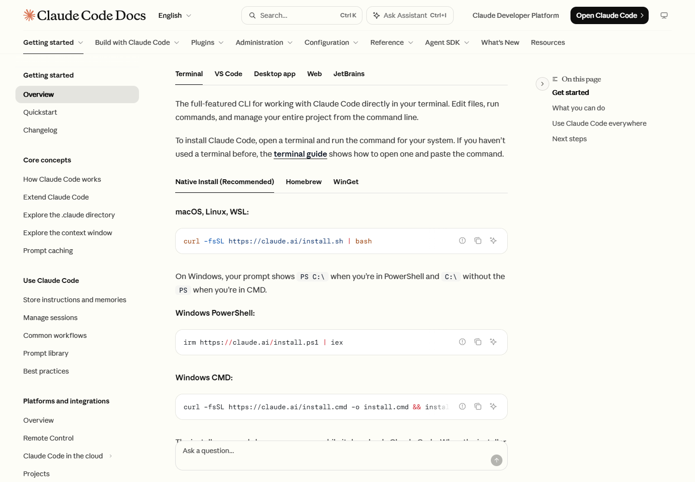

Commands use Paper Mono, with copy controls and installation choices close to the code.

[Record](../../data/interaction-checks.json)

## Original explanatory diagrams

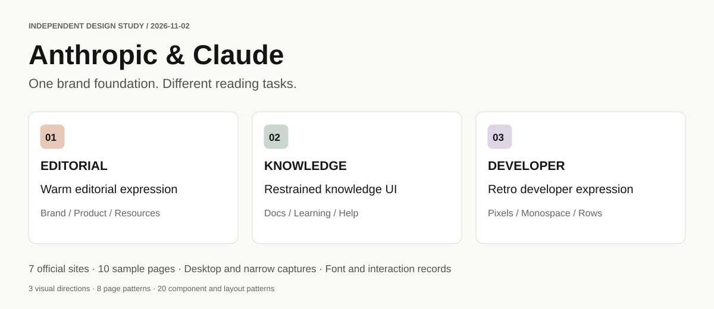

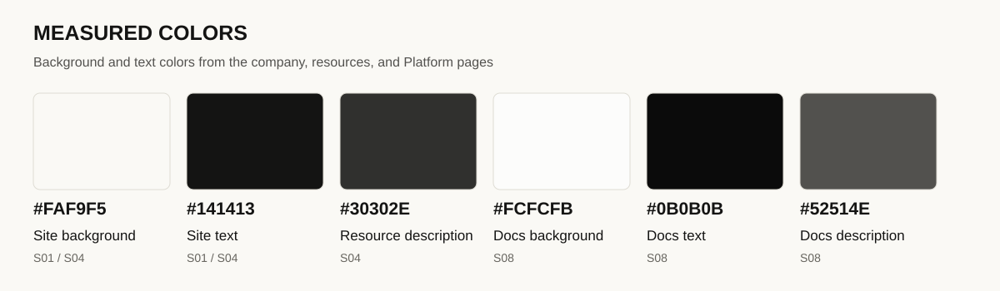

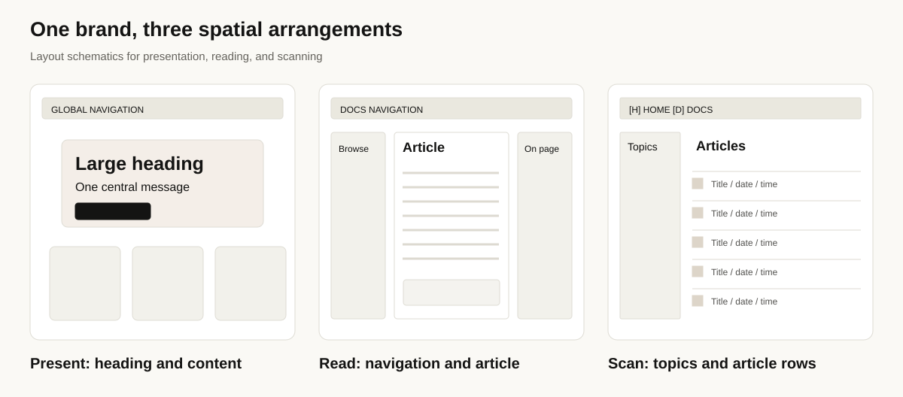

These three diagrams organize visual directions, sampled colors, and spatial arrangements for comparison with the screenshots.

[Next: Methods and evidence](07-methodology-and-sources.md)
