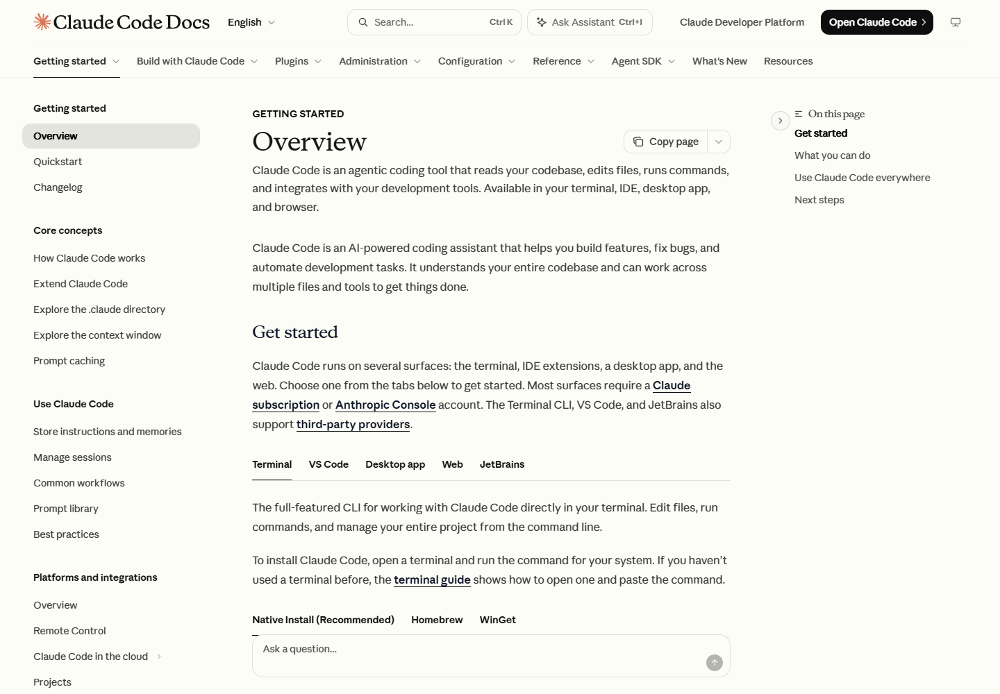

# 09 Page anatomy: from attention to action

[中文](../09-page-anatomy.md) · **English**

[Overview](../../README.en.md) · [Previous: Application guide](08-application-guide.md) · [Next: Cross-site matrix](10-cross-site-matrix.md)

Dividing a page into regions reveals how typography, spacing, and components organize reading together. These resource, documentation, and course examples follow three questions: what appears first, how readers orient themselves, and what they can do next.

## Resources: from a content impression to search

| Region | Visible treatment | Relationship to reading and action |
|---|---|---|
| ① Two navigation levels | Site-wide product and company links above resource categories | Separates site direction from the current collection |
| ② Peripheral article cards | Titles, types, dates, or topics; some cards extend toward panel edges | Suggests content breadth and gives browsing readers clues |
| ③ Central heading and description | A 72px serif heading with a 23px description and surrounding space | Establishes a clear visual center |
| ④ Search below the description | An input with a keyboard-shortcut hint | Connects understanding the page to finding content |
| ⑤ Pale grid and borders | A #F5F4ED panel with faint dividing lines | Gives the cards, heading, and search a common surface |

**Reading sequence:** recognize the library → understand its range → browse an article or search. The center and peripheral cards support two routes: direct retrieval for a known question, or title scanning for exploration.

**Reusable combination:** P02 category bar + P05 search + P09 large-heading hero + P10 card grid. For another library, establish its classification and retrieval entrances before choosing the visual weight of surrounding content.

[Source S04](https://claude.com/resources) · [Font, size, and color measurements](../../data/pages/claude-resources.json)

## Documentation: three scales of orientation

| Region | Visible treatment | Reader's question |
|---|---|---|
| ① Top tools | Search, documentation categories, and site entrances | Which documentation area should I enter? |
| ② Left navigation | Group headings and articles; a background highlights Overview | Where am I in the documentation? |
| ③ Central article | Heading, introduction, Get started, and installation choices | How do I begin this task? |
| ④ Right contents | Sections of the current article | What does this article contain? |
| ⑤ Platform and installation choices | Terminal, VS Code, and other choices before their instructions | Which instructions apply to my environment? |

The heading measures 36px and body text 16px. The heading sets hierarchy, the body supports continuous reading, and the two sides provide different scales of orientation. At the narrow viewport, the heading becomes 30px while body text remains 16px and navigation becomes compact.

### Alongside Platform documentation

| Feature | Claude Code documentation | Claude Platform documentation |
|---|---|---|
| Desktop structure | Navigation tree, article, page contents | Navigation tree, article, page contents |
| Sampled main heading | 36px / 40px line height | 26.25px / 32.8125px line height |
| Heading font | Anthropic Serif Display | Anthropic Serif |
| Code font | Paper Mono | Anthropic Mono |
| Getting-started structure | Platform and installation-method choices | Numbered steps and code examples |
| Shared logic | Keeps orientation, explanation, and execution entrances nearby | Keeps orientation, explanation, and execution entrances nearby |

**Reusable combination:** P04 sidebar navigation and contents + P07 content switching + P19 code and copy. Platform also uses P15 numbered steps for its introductory flow.

[Code Docs S07](https://code.claude.com/docs/en/overview) · [Platform S08](https://platform.claude.com/docs/en/get-started) · [Code measurements](../../data/pages/code-docs.json) · [Platform measurements](../../data/pages/platform-docs.json)

## Lessons: establish learning expectations first

*Video content was not visible during capture; the heading, learning goals, and section navigation were visible.*

| Region | Visible treatment | Support for learning |
|---|---|---|
| ① Breadcrumbs | Academy, Courses, and the course title in a hierarchy | Places a lesson within its course |
| ② Title and duration | Lesson 1 and 15 min below a serif title | Identifies the subject, position, and expected commitment |
| ③ Learning-goals callout | An “In this lesson” group with separate goal rows | Establishes expectations before the main material |
| ④ Right-hand sections | Current lesson, takeaways, exercises, and next steps | Shows the sequence within the lesson |
| ⑤ Content formats | A video region and transcript selection | Offers viewing and text-reading entrances |

**Reading sequence:** confirm course position → review goals and commitment → learn the material → review takeaways and exercises → continue. Duration and goals help readers decide whether the lesson fits their current needs.

**Reusable combination:** P03 breadcrumbs + P18 callout + P20 duration and position, connected by P17 format switching and P16 next-lesson navigation.

[Source S06](https://academy.claude.com/courses/ai-fluency-framework-foundations/introduction-to-ai-fluency) · [Measurements](../../data/pages/academy-lesson.json) · [Transcript check](../../data/interaction-checks.json)

## How the three pages allocate attention

| Page | Establishes first | Orientation | Next action |
|---|---|---|---|
| Resources | Content range and topic | Categories, search, cards | Choose content |
| Documentation | Current technical task | Navigation tree, contents, platform choices | Follow steps and use code |
| Lesson | Learning goals and commitment | Course hierarchy and sections | Learn, practice, continue |

Shared type and surface colors produce different rhythms in these structures. Start with the reader's route, then choose heading proportions, navigation levels, and action entrances to support it.

[Next: Cross-site design matrix](10-cross-site-matrix.md)
